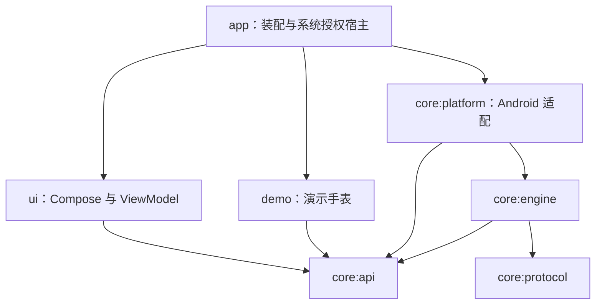

# 架构

手机端是一个 APK、多个 Gradle 模块；手表端是另一台设备上的独立 APK（Local Bridge），二者使用相同的 applicationId 和签名。手机最低 Android 14（API 34），手表最低 API 30。

## 1. 模块

| 模块 | 职责 | 约束 |
|---|---|---|
| `:app` | 唯一的手机 APK：Manifest、依赖装配、系统授权的 Activity 宿主 | 不放协议或业务实现 |
| `:ui` | Compose 页面、视图模型、设计系统、导航 | 只依赖 `core:api`，不直接访问 socket、数据库或 token |
| `:demo` | 演示手表：`core:api` 所有客户端的内存实现和示例数据 | 由 `:app` 切换，UI 不区分真假会话 |
| `:core:api` | 公开的类型、StateFlow、操作、错误和取消语义 | 纯 Kotlin/JVM，不暴露 BluetoothSocket、Channel token、Compose 或 Activity |
| `:core:protocol` | 字节编解码、protobuf 字段、业务格式 | 纯 Kotlin/JVM，与 Node 的固定向量交叉验证 |
| `:core:engine` | 会话、Channel、Setup、DataApi、伴侣和健康业务的状态机、重试、超时、游标 | 通过抽象的传输、时钟和存储接口工作 |
| `:core:platform` | Android 蓝牙、CDM、通知、电话、媒体、SQLite、HTTP、安全存储、前台服务和后台恢复 | 实现 engine 的接口，不持有界面 |
| `:thirdparty:kadb` | 固定版本的 Kadb（无线 ADB），见其 [README](../../android/thirdparty/kadb/README.md) | 改用 Android `SSLSocket`；ADB 帧、流复用和 SPAKE2 配对逻辑保留 |
| `:watch:healthbridge` | 手表 Local Bridge：健康读取、增量队列、专用蓝牙、找手表、勿扰同步、root 工具中继 | 无 INTERNET 权限 |
| `:watch:toolboxagent` | 工具箱 Agent（由 `app_process` 启动），随手表 APK 分发 | 同一份代码既用于 ADB，也用于 root |
| `:watch:healthmodule` | 可选的 Magisk / Zygisk 模块 | 纯 Java DEX + 系统库的原生引导，不依赖 Kotlin 运行时 |



这是编译依赖，不是数据方向。核心通过构造器获得传输、时钟和存储；没有本地 HTTP 服务或 AIDL。默认单进程：模块化提供编译边界和独立测试，但不提供崩溃隔离。

## 2. 服务与生命周期

蓝牙 socket、Channel 和会话协程不属于 Activity 或页面的 ViewModel。非导出的 [BackendSessionService](../../android/core/platform/src/main/kotlin/dev/ticbox/companion/platform/service/BackendSessionService.kt) 持有 `AndroidCompanionRuntime`，在收到真实连接请求后以 connectedDevice 类型的前台服务运行，`START_STICKY`。

- [CompanionApplication](../../android/app/src/main/kotlin/dev/ticbox/companion/CompanionApplication.kt) 持有进程级的绑定，从 `LocalBinder` 取出 `client: WatchClient` 和 `services: CompanionServices` 交给 UI。页面不 import Service 或 Binder，也不创建 engine。
- 页面或 Activity 解绑时不调用 `client.close()` 或 `stopService()`；离开页面后，已开始的会话继续由服务管理。`close()` 只由所有者调用。
- 宿主要把“这次绑定请求的登记与清理”和“已经拿到可调用的 Binder”分开管理：`bindService` 返回 false、抛出 SecurityException、返回空 Binder，或回调前页面已退出，都要 `unbindService`。绑定失效时停止使用旧引用，重新绑定后重新收集新实例的 StateFlow。
- `BackendSessionService.start(context, peer)` 是从宿主提交连接的便利入口（先保存意图，再请求前台服务）；它和 `client.connect()` 二选一，不要重复提交。
- 进程被杀后，节点身份、已完成的步骤和同步游标从持久存储恢复；socket 和临时句柄重新建立。后台恢复见[连接](connection.md)。

权限弹窗、蓝牙配对确认、CDM 同意和登录需要界面宿主：[SystemPairingHost](../../android/app/src/main/kotlin/dev/ticbox/companion/SystemPairingHost.kt) 和 [SystemGoogleHost](../../android/app/src/main/kotlin/dev/ticbox/companion/SystemGoogleHost.kt) 在 Activity.onCreate 中创建，绑定后 attach `binder.pairingActions` / `binder.googleActions`，解绑时 detach。它们从 resumed 的 Activity 打开系统界面，按独立的 action key 接回结果并保存旋转状态；后端只描述“需要哪种用户动作”，然后核查真实的授权状态。

## 3. 前后端接口

原则：**操作向下提交，状态向上订阅**。UI 提交业务操作（连接、刷新、修改目标），不提交协议路径或十六进制消息；后端以 StateFlow 提供连接阶段、同步进度、最后成功时间、记录和错误原因。发起请求、本地传输完成和对端业务完成是三个不同的状态，UI 不能把点击成功或请求入队显示为完成。页面重组、导航返回或订阅变化不能隐式触发重复配对、重放有副作用的命令或销毁会话。

### 3.1 WatchClient

```kotlin
interface WatchClient : AutoCloseable {
    val state: StateFlow<WatchSnapshot>
    suspend fun connect(peer: PeerAddress)
    suspend fun disconnect()
    suspend fun refreshBattery()
    suspend fun refreshHealth()
    suspend fun setStepGoal(goal: Int)
    override fun close()
}
```

| 操作 | 前提 | 正常返回表示 |
|---|---|---|
| `connect(peer)` | 有服务客户端；服务检查蓝牙权限和开关，RFCOMM 要求系统绑定 | 请求已交给服务，**不等待连接成功**；之后订阅状态 |
| `disconnect()` | 客户端有效 | 停止连接和自动重连；不等于解除配对或重置手表 |
| `refreshBattery()` | `LINK_READY` | 本地请求已写出；电量以之后的 `state.battery` 为准 |
| `refreshHealth()` | `LINK_READY` 且已开启 Mobvoi 云 | 会让手表同步云端；未开启时抛 `CloudFeatureDisabledException` |
| `setStepGoal(goal)` | `LINK_READY`，goal 为正 Int | 请求已写出，手表也会尝试云同步；界面在发送前提醒并请用户确认 |

`PeerAddress("aa:bb:cc:dd:ee:ff")` 规范化为大写 MAC，不是设备名、GMS 节点 ID 或 CDM associationId。服务对并发的连接和断开采用新请求优先，始终以最新的 `state.connection` 为准。

| 错误 | 信号 | UI 的处理 |
|---|---|---|
| 链路未就绪 | `NotConnectedException` | 提示等待或重新连接，不循环重发 |
| 服务已销毁 | `BackendClosedException` | 丢弃旧引用，重新绑定 |
| 输入不合法 | `IllegalArgumentException` | 表单提示 |
| 权限或平台能力 | 平台异常，或异步的 `failure` | 检查实际状态，由 Activity 发起系统交互 |
| 后台连接失败 | `ConnectionState.failure`、`RETRYING / FAILED` | 这是异步状态，`try/catch connect()` 捕获不到 |
| 报文无法解释 | `WatchSnapshot.lastDataIssue`，保留旧观测 | 非致命提示 |
| 协程取消 | `CancellationException` | 继续抛出，不当作失败 |

不要依据异常 message 的文字分支。服务一旦接受请求，请求就属于服务，取消页面的 await 不会撤回它；不要用页面退出去取消或重发业务命令，也不要在 UI 中另做自动重试。

### 3.2 状态

`WatchSnapshot` 包含 `connection: ConnectionState`、`battery`、`steps`（`WatchObservation`：值、手机接收时间、stale）和 `lastDataIssue`。

| `ConnectionPhase` | 含义 | 可以发业务命令 |
|---|---|---|
| `IDLE` | 未连接或已断开 | 否 |
| `CONNECTING` | 正在连接 | 否 |
| `NEGOTIATING` | 正在建立协议会话 | 否 |
| `LINK_READY` | 数据链路已连接；不代表手表已激活或某个业务端点可用 | 是 |
| `RETRYING` | 中断后自动重连 | 否 |
| `FAILED` | 需要处理连接问题 | 否 |

`ConnectionState` 还包括 `peer`、`sessionId`（本实例内的一次物理连接，自动重连也会换新）、`peerName`、`negotiatedWireVersion`、`retryAttempt`、`retryDelayMillis`、`failure`（`TRANSPORT / TIMEOUT / PROTOCOL / IDENTITY / PERMISSION_REQUIRED / UNEXPECTED`）以及消息丢弃和业务处理失败的计数。暂时性的传输失败按 1–30 秒带抖动退避，持续重试直到显式停止（[SessionConfig](../../android/core/engine/src/main/kotlin/dev/ticbox/companion/engine/SessionConfig.kt)）；UI 不另开重连定时器。`IDENTITY` 不能靠删除节点文件解决。

- `battery == null` 表示没有有效观测，不能显示为 0；有效的电量和步数可以是 0。
- `receivedAtEpochMillis` 是**手机接收时间**，不是手表采样时间。
- `stale=true` 表示观测不属于当前就绪的会话，不是按时间过期。断开重连后保留旧值并标 stale，新会话收到新值后才更新；重连本身不刷新电量。切换设备清除另一设备的观测。
- 手表页显示期间，每次连接就绪后调用一次 `refreshBattery()`，之后距上次请求或收到电量满 10 分钟再调用一次。

### 3.3 CompanionServices

`LocalBinder.services` 提供其余工作流，类型定义都在 [core:api](../../android/core/api/src/main/kotlin/dev/ticbox/companion/api/CompanionServices.kt)。

| 入口 | 内容 | 完成语义 |
|---|---|---|
| `privacy` | 云和代理能力的开关 | 默认全关；允许不等于已登录或远端成功 |
| `pairing`、`unpair` | 配对与权限同步、保留数据的解除配对 | 关联、绑定、链路、同意和 CDM 回调分别记录 |
| `setup` | 首次设置的 probe / start / resume / cancel | start 被接受不等于完成；手表 COMPLETE 与 OOBE 分开记录 |
| `recovery` | 保存的连接意图、等待原因、resume | RUNNING 表示已交给会话引擎 |
| `data` | DataItem 范围、分页缓存、Asset、requestSync、可选的进度屏障 | 本地提交、实际发送和远端屏障是三件事 |
| `notifications` | 同步开关、应用过滤、提醒策略、授权和镜像状态 | 动作成功表示系统接受了 send |
| `calling` | 通话状态、权限、接听 / 挂断 / 拨号 / DTMF、音频端点 | 以 Telecom 的实际回调为准，音频依赖 HFP |
| `media` | 媒体摘要、按键、进度、音量、自定义动作和队列 | 应用的实际响应另看回调 |
| `finding` | 手表找手机的本地响铃；手机找手表 | 播放和振动的回报与请求状态分开 |
| `deviceSettings` | 设备信息、语言、时间、应用、设置页、锁屏配置 | 本地提交、远端打开和最终状态分别记录 |
| `watchFaces` | 表盘目录、预览、收藏、切换、照片表盘、MWF ZIP | ZIP 传输完成不等于安装完成 |
| `sos` | 紧急求助的联系人和行为 | 见[功能](features.md) |
| `dnd` | 勿扰同步 | 见[工具箱协议](../spec/toolbox.md#7-勿扰同步) |
| `toolbox` | 无线 ADB 和 root Local Bridge 两种工具后端 | 见[工具箱协议](../spec/toolbox.md) |
| `monitoring`、`healthModule`、`notificationAlertPatch`、`watchModuleHost` | 健康监测设置、进程内模块的安装和状态、SystemUI 提醒补丁 | 见[监测与提醒设置](../spec/monitoring-settings.md)和[通知的声音与振动](../spec/notification-alerts.md) |
| `network` | Flow15 代理状态 | LISTENING 是本机监听，ACTIVE 是代理握手完成 |
| `history` | 本机收到的电量和步数观察 | 时间是手机接收时间 |
| `localHealth` | 本地健康同步、取消、状态和变更日志 | 见[本地桥接协议](../spec/local-bridge.md) |
| `healthRecords` | 原始行、结构化的点、睡眠、运动的查询 | 只读手机缓存，不联网；未采集过的来源返回 `SOURCE_UNAVAILABLE` |
| `account`、`health` | Mobvoi 账号与健康云 | 见[账号与云](../spec/cloud.md) |
| `google` | 账号复制、云同步设置、诊断设置 | 以 GMS 回调为准 |

数据的导出与导入（`DataMigration`）不在 `CompanionServices` 中，由 `:app` 的 `CompanionApplication` 直接提供给设置页，见[数据迁移](data-migration.md)。

## 4. 引擎要点

- **请求**：`SessionEngine.request(peer, sessionId, path, payload, timeoutMillis, route)` 在同一个写锁内分配 requestId 并登记，关联 token 按官方的 Java int 运算 `((generation + 527) * 31) + requestId`（本地新请求 generation=0）。回复的 path 不要求等于请求的 path。
- **处理器**：`registerRequestHandler` 和 `registerMessageHandler` 在独立的 dispatcher 和有界队列中运行，不阻塞 Channel 的读取；重复且内容相同的请求复用运行中的处理或缓存的结果。注册跨重连保留，队列和 pending 只属于当前物理会话，断线时清理，旧租约不能写入新会话。
- **容错**：protobuf 的标量重复时以最后一个为准，子消息合并；不可读的完整 envelope 记录后继续下一帧。异常的回复按官方默认值或请求上下文尽量解释并记录，不增加客户端独有的严格校验，但保留设备和会话归属以及资源预算。
- **数据初始化**：每次物理连接发布手机能力 `ticwatch_phone_connect`，并写入语言、24 小时制和手机 SDK 等共享设置（相同值不重复写入）。
- **存储**：SQLite（`data-sync.sqlite`）保存 DataItem、来源游标、Asset ACL、电量和步数观察（默认最多 100000 条）、健康和云缓存；DataItem 与游标原子提交，Asset 提交后才 ACK，共享 128 MiB 预算。
- **日志**：诊断异步写入 `no_backup/protocol-diagnostics/` 的轮转文件（Logcat 标签 `TicBoxProtocol`），不阻塞协议处理；不记录健康数值、凭据、正文或个人内容。

## 5. 界面

### 5.1 结构

| 一级入口 | 内容 |
|---|---|
| 手表 | 手表示意图（屏幕内为当前表盘预览）、连接和电量、今日步数；表盘、通知；手表偏好（设备信息、应用、屏幕锁、健康监测、设置页）、查找、媒体、电话、紧急求助、连接、高级（工具箱） |
| 健康 | 日期和同步状态、步数 / 心率 / 睡眠 / 血氧卡片、步数目标；运动记录；其他活动和身体指标；记录页和手表资料 |
| 设置 | 隐私、Mobvoi 账号与云、Google 服务、语言、外观、连接通知、诊断 |

未配对时手表页显示欢迎页（添加手表 / 试用演示手表）。协议细节集中在“设置 → 诊断”，包括会话、协议版本、计数、恢复原因、健康同步各阶段的耗时，以及“收到的读数”和“已保存的健康记录”两个原始数据页。

### 5.2 实现

- **会话**：`SessionController.state` 为 `Connecting / Unavailable / Ready(WatchSession)`，`WatchSession` 包含 `WatchClient` 和 `WatchUiServices`。`:app` 的 `ServiceSessionController` 绑定服务，并可以切换到演示手表；会话切换时导航回手表首页并清空其他 tab 的返回栈。
- **视图模型**：每个页面一个 ViewModel，经 `companionViewModel { deps -> … }` 取得依赖。健康总览和详情共享按导航图作用域的 `HealthViewModel`。
- **命令**：`CommandRunner` 在 application scope 中执行后端命令，离开页面不会取消写入；每个命令有 key，只禁用对应的控件。异常映射为本地化提示，结果用 snackbar 显示。
- **导航**：navigation-compose 类型安全路由，三个 tab 各为嵌套图。tab 首页按返回由系统播放回到桌面的预测动画。
- **转场**（`PageMotion.kt`）：NavHost 的转场全为 None，每页按自己的角色和转场进度绘制，避免被打断的转场重放过时的动画。tab 之间在离屏图层中用 `BlendMode.Plus` 交叉淡入；返回仿照系统的跨页返回，关闭的页面缩小为圆角卡片。
- **演示手表**：`DemoWatch` 在内存中实现所有 `core:api` 客户端（14 天的健康记录、示例运动、表盘预览、模拟的配对和设置、账号、云和通话）。唯一的标识是底部横幅和“退出演示”；进入演示不断开真实服务，演示状态不持久化。高级页面复用真实的无线 ADB，可以操作真实的 Android 设备。
- **健康数据**：`HealthRecordsLoader` 读取 `points()` / `sleepRecords()`，只绘制后端确认了语义和单位的值，按日缓存最多 45 天，一次同步完成（`lastSuccessAtMillis` 变化）后才重读。展示规则见[健康数据展示参考](../spec/health-display.md#8-本应用的图表投影)。
- **弹窗与键盘**：先交给平台处理；主窗口为 adjustResize，页面自己留出边距；占满屏幕高度的对话框窗口关闭 `decorFitsSystemWindows`，用 insets 留出边距。底部弹窗统一使用 `AppBottomSheet`（原始的 `ModalBottomSheet` 被甩过状态栏时不会停止）。

### 5.3 设计系统

- Material 3；可以关闭动态配色，使用品牌绿色调色板；主题跟随系统 / 浅色 / 深色。健康配色固定，不随壁纸变化。
- `WatchIllustration`：圆形手表、贯穿表壳的表带、三点钟位置的表冠，屏幕内可以显示表盘预览。欢迎页、配对页和手表首页共用。
- 图标统一为 Material Symbols（Outlined）：`tools/import-material-symbols.mjs` 按 `android/ui/design-assets/material-symbols/icons.json` 从固定 revision 下载 SVG，生成 vector drawable 和带 SHA-256 的清单。
- 组件：`PageScaffold`、`PageColumn / PageList`（16 dp 边距，宽屏 640 dp 居中）、`ListGroup`、`NavigationRow / SwitchRow / RadioRow / ValueRow`、`StatusBanner`、`EmptyState`。`SwitchRow` 有自己的布局，因为 `ListItem` 在摘要从一行变为多行时会跳动 16 dp。
- 动效：出现和消失用 `Reveal / RevealValue`，下方内容跟随移动；切换用 `FadeSwitch / FadingText`；进度用 `BusyBar / ProgressBar`，在上报值之间平滑移动。

### 5.4 多语言

字符串使用 `stringResource / pluralStringResource` 和格式化参数，不拼接片段。默认英文，`values-zh` 和 `values-b+zh+Hant` 保持相同的 key 和参数（`StringResourcesTest` 检查）。应用语言通过 `LocaleManager.applicationLocales` 设置。`MainActivity` 自己处理语言、主题、旋转、字体和键盘等配置变化，不重建 Activity。只打包 en / zh 资源（`localeFilters`），`supportsRtl="false"`，不支持的系统语言显示英文。手表 Local Bridge 跟随手表系统语言显示英文、简体或繁体。

## 6. 测试

- 后端使用固定的协议向量、畸形输入、分片和乱序、虚拟时钟、模拟断线和身份存储；Kotlin 实现与 Node 的固定字节向量交叉验证。
- 界面使用 Fake 后端和演示手表，生成连接中、断线、授权不足、同步中、空数据、长记录和错误等状态，不需要连接手表。没有设备时，可以用临时的 Robolectric NATIVE 图形测试把页面渲染成 PNG 查看（不要提交）。
- UI 测试不能在 Dialog 窗口中打开文本输入框：Robolectric 下会挂起并污染整个测试 JVM。
- 终端模拟器（termlib）的原生库无法在 JVM 上加载，终端页面的测试使用 `TerminalDisplay` 的假实现，只验证页面逻辑。
- 单元测试和模拟界面不能代替真实设备上的互通验证。
