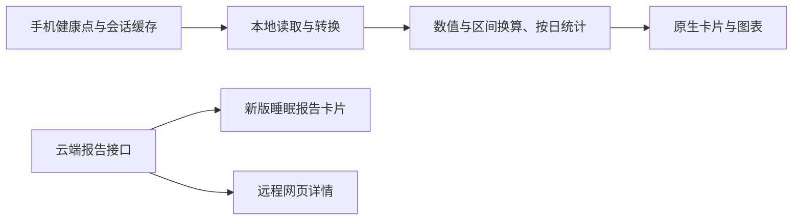

# 健康数据展示参考

本文记录官方手机 App（Mobvoi Health 5.3）和手表应用（TicHealth、TicFitness）如何统计、换算和展示[健康数据](health.md)与[私有运动数据库](fitness-database.md)中的数据，供界面实现参照。这些都是官方的**展示策略**，不是数据契约：原始值、区间、异常值和未知字段一律保留，官方的补零、丢弃负值、提前取整等做法不能反过来变成解析或入库规则。

## 1. 数据分层

官方并不把手表上的一行原始值直接交给页面：

本应用按三层处理：完整的原始行；按类型解释后的时间序列、圈和阶段；用于图表和统计的派生结果。只有第三层由界面决定，前两层由后端保证不丢失。

界面应区分以下状态，不能统一显示为“没有数据”：来源尚未采集、来源被拒绝、查询没有匹配记录、可用且记录为 0、只读到摘要、部分读取。官方活动卡片在三个总值都为 0 时判为无数据，本应用不照搬这一空态。

官方的默认目标（10000 步、30 运动分钟、10 活动小时）以及默认的入睡和起床时间（23:00、08:00）只是缺少记录时的回退值，不能显示为手表返回的个人设置。

## 2. 时间、分页与缺失

官方很多原生页面按**手机当前时区**划分日界、半小时桶和 HH:mm 格式，并且有“一天固定 86400 秒”的旧假设。本应用应明确一个显示时区，按该时区的日历日计算区间，不能用固定 24 小时的步长替代跨夏令时的日期运算。记录本身没有时区字段。

- `startMillis / endMillis` 是源时间；`raw.updatedAtMillis` 是手机入库时间；`lastSuccessAtMillis` 是同步状态的时间。三者不能互相替代。
- 普通查询的时间过滤是闭区间重叠，跨日的记录会在相邻两天都命中；展示时再裁剪，并按 `source + kind + key` 去重，不修改原始记录。
- 有 `nextOffset` 表示还有下一页。统计整个时间窗时必须读完所有页；缓存刷新后从 offset 0 重读。
- 非有限或无法解释的值不参与绘图，但原始详情仍可展示，并带上 issue；不能补 0，也不能删除整行。
- 缓存可读不等于本次同步成功。SESSION 可用而 POINT 不可用时，`relatedPointsStatus` 会单独报告，不能画出空的睡眠分期。
- 被动收到的当前步数和电量是手机接收时的最新值，不能与历史采样相加，接收时间也不是采样时间。

## 3. 活动、步数与目标

### 3.1 增量类型

| POINT 类型 | 首值 | 依据 |
|---|---|---|
| 8 DeltaCalorie | 区间热量，kcal | 官方写入 Health Connect 时以 `Energy.kilocalories(首值)` 构造 TotalCaloriesBurnedRecord |
| 9 DeltaDistance | 区间距离，m | 以 `Length.meters(首值)` 构造 DistanceRecord；活动详情最后才换算为 km 或 mile |
| 10 DeltaStep | 区间步数 | 首值转为 long 后构造 StepsRecord（这是官方的截断策略，不能成为丢弃小数的理由） |
| 39 ClimbingStairs | 区间上升高度，m | 构造 FloorsClimbedRecord 时把首值除以 3；资源中定义每层 3 米 |

四类都读取 CSV 首值，并保留 `time_from / time_to` 的区间，不是预先算好的日总量或小时数组。手表 TicHealth 5.6 把步数、距离、热量和爬楼事件分别保存为这四类，直接使用事件区间和首值，不累计成日计数，也不在入库前把高度除以 3。

旧格式的 4 Calorie 和 5 Distance 是累计快照：官方在同一手机本地日内做差，首值从日初算起，非增加的部分贡献 0。8、9、10 已经是增量，直接使用，**不能再做差**。

### 3.2 日汇总

1. 每条记录按区间与桶的交集时长比例分摊，日内桶为 30 分钟。
2. 同类区间重叠时拆分，对同一重叠片段取较大的贡献，而不是全部相加。官方的汇总丢弃非正值，这是展示策略。
3. 再按手机本地日和半小时桶汇总；整日结果累加浮点贡献，取总量时才 `Math.round`。
4. 运动缓存合并时，排除运动记录另外派生的步数、热量和距离增量，避免与健康点重复，但仍可补充运动时长。

| 项目 | 官方处理 | 本应用注意 |
|---|---|---|
| 步数 | 转换和区间处理后汇总，不是直接相加所有同名点 | 不要再加被动收到的当前步数 |
| 运动时长 | 部分 Motion 状态推导出秒数（FastWalk、Run、FastRun、Bike、FreeTrain、Swimming 计入，普通 Walk 不计入）；也可读取运动记录的时长 | 图上的分钟是秒数 / 60 取整后的显示值 |
| 活动小时 | 某小时累计至少 100 步计 1 小时，限制在配置的小时范围内 | 100 是该版本的派生规则，不是解析阈值 |
| 距离 | 日总值按设置从米换算为 km 或 mile | 换算只影响显示 |
| 目标 | 读取 GoalToday* 记录的最新值，缺失时用默认值 | 默认值不是个人目标 |

官方图表的数据对象中，日图的 `time` 是相对日初的半小时序号，周、月图是相对窗口起点的日期序号，不是 epoch 时间。手机还有一套派生的 DataType（Step 0、Exercise 1、Active 2），与 POINT 类型编号无关。

### 3.3 爬楼

专用的爬楼详情使用另一套规则：日视图按 **time_to** 归入半小时桶，周视图按星期，月视图按日期，只收正值；每桶先累计高度再 `Math.round`，总楼层为这些整数高度之和**整数除以 3**。周、月的平均值是总楼层除以有数据的桶数。写入 Health Connect 时则逐行除以 3，保留小数。

合成示例：同一半小时桶内两行上升高度为 3.4 米和 0.8 米，合计 4.2 米，按每层 3 米为 1.4 层；详情页先把桶取整为 4 米，再整数除以 3，得到 1 层。

## 4. 心率、血氧、压力与温度

官方详情页在手机上计算统计值，不是直接读取云端的平均值字段。

| 指标 | 主数字 | 日图 | 周 / 月图 | 输入 |
|---|---|---|---|---|
| 心率 | 普通入口为静息均值，部分入口为平均值；不是最新一条 | 默认 10 分钟，部分入口 1 分钟 | 每日最小 / 最大值范围 | POINT 1；静息另需 2；告警另需 15 |
| 血氧 | 期间样本均值 | 每小时最小 / 最大值范围 | 每日最小 / 最大值范围 | POINT 28，单位 % |
| 压力 | 期间均值 | 每 30 分钟的最大值 | 每日最大值 | POINT 29；压力指数，不是血压或百分比 |
| 温度 | 最新一条；分析项显示期间最大值 | 按 10 分钟横坐标定位，均值画虚线 | 不提供 | POINT 32；不能与皮温 42 混用 |

### 4.1 心率

1. **平均和极值**：取正的心率样本，按样本数求均值并取整，同时求最小和最大值；不是按采样间隔做时长加权。
2. **静息均值**：先从 Motion 的 Static 区间裁剪到窗口，再选择落在其中的心率样本；最后一条 next_state=Static 时可以延伸到窗口结束。没有静止区间时显示缺失，官方模型中的 0 不是测到 0 bpm。它也不等于睡眠心率均值。
3. **告警次数**：统计 POINT 15 中首值为 17 或 18 的条数，不是用界面阈值重新判断所有心率样本；17、18 不是心率。

日图按桶组织，但代表值可能优先保留命中的全局极值，不总是桶均值；虚线优先用静息均值，缺失时用期间均值。界面应标明显示的是最新值、平均值还是静息值。

### 4.2 血氧

查询窗口按 `time_to` 半开，但分桶使用 `time_from`（官方变量名叫 uploadTime，其实仍是采样时间，不能显示为上传时间）。样本均值四舍五入，不乘除 100。首页用 95 划分正常和偏低，详情页却用 80 统计低值样本，这是同一版本中两个展示分支的差异，不能变成统一的校验。低值次数是样本条数，不是分钟数；样本不能因展示阈值被丢弃。

### 4.3 压力

每桶画最大值，主数字为整个窗口的样本均值。四档为 `<25`、`[25,50)`、`[50,75)`、`>=75`，依次为放松、轻度、中度、重度。各档占比按样本数计算，并用最大余数法分配整数百分比使合计为 100；它不表示持续时长。官方只统计正值。

### 4.4 温度

温度页面读取 POINT 32，按设置换算 `°F = °C × 1.8 + 32`，显示最新值和最大值；10 分钟横坐标只是定位，不是先对 10 分钟的样本求均值。官方手机 5.3 中没有找到呼吸率 38 和皮温 42 的完整统计页面；本应用对这两类的展示依据手表 TicHealth 5.6 的写入语义，不称复刻了官方算法。

手表的皮温页面使用一个账号级的个人基线：手表在登录状态下每 12 小时最多请求一次 `GET /user/getSkinTemperature`，把 `user_info.skin_temperature_base` 按摄氏度缓存，睡眠期间的皮温均值与它做差（摄氏和华氏使用同样的换算后再相减）。页面在连续三天有数据、且有正的基线时才显示结果；**三天只是界面的就绪条件，不是服务端的算法**。没有基线缓存时无法从 POINT 或 SESSION 还原官方的值，本应用自行计算的离线基线必须使用自己的名称和算法说明。

## 5. 睡眠

官方手机 5.3 有两条链：**新首页使用云端的 SleepReport，新详情打开远程网页；旧的原生会话 + Motion 处理链仍保留在 App 中。** 本应用参照旧链做本地展示，不称恢复了新网页的计算。

### 5.1 分期编码不能混用

| 分期 | 本地 Motion 状态 | 云端 SleepMotion.value |
|---|---|---|
| 清醒 | 7 | 1 |
| REM | 8 | 2 |
| 浅睡 | 9 | 3 |
| 深睡 | 10 | 4 |

本地的 1 到 4 是运动状态，不能再按云端的表重新映射。

### 5.2 卡片与详情

| 展示 | 官方处理 | 本应用参照 |
|---|---|---|
| 新首页的主记录 | 对每份云报告的所有片段时长求和，取最大的一份；其余报告不在卡片上 | 选一个主睡眠，并保留其他会话的列表；不要强行合并所有会话 |
| 新首页的时长 | 上述片段总时长，可能包含清醒或未知片段 | 不是纯粹的睡着时长 |
| 新首页的分数 | 云端 sleepQuality 换算为百分制 | 服务端算法未知，不能用本地效率冒充 |
| 新详情 | 网页 `/#/sleep/<日期>?mode=day/week/month`，传入日期和时区偏移 | 本地页面不依赖它 |
| 旧原生日主睡眠 | 从当日结束的会话中选在床时长最大的，其余放在记录列表 | 可以参照，并允许查看每个原始会话 |
| 旧 InSleep | REM + 浅睡 + 深睡的时长之和 | 可以作为“已识别的睡眠时长”，未知区间不补成睡眠 |
| 旧 InBed | 有分期时为所接受区间的总覆盖；没有分期但会话已结束时，回退为会话跨度 | 与睡着时长、会话跨度分别命名 |
| 旧本地分数 | `round(InSleep × 100 / InBed)`（另有手环专用的分期加权公式） | 可以作为写明公式的本地派生值，不称官方评分 |

官方“开始睡眠”按钮进入的是手机端的鼾声录制，不存在远程启动手表睡眠采样的命令。

### 5.3 日、周、月统计

- 旧版按 **session.end 所在的手机本地日期**归属一夜睡眠。本应用的睡眠查询默认按区间重叠，如需同样的口径，取得完整候选后再按结束日期分组，未结束的会话单独列出。
- 同一天的多次会话，各分期时长相加；平均时长为总在床时长除以**有数据的天数**，不是除以 7 或当月天数。平均分数按会话数平均，不按时长加权。最长和最短比较的是单次会话，不是某天的合计。
- 分期占比按期间的分期总时长计算，不是每日百分比的平均；整数百分比可以用最大余数法分配。缺口和未知区间不能分摊进已知的四个分期。
- 旧版平均入睡和起床时刻先跨午夜展开，再按会话算术平均；混入午睡后可能难以解释。本应用可以分别展示主睡眠习惯和午睡记录，并说明算法。
- 图表保留 7 天或当月天数的位置，只画有记录的桶；缺失的日期不是“睡眠 0 分钟”。上一周期没有记录时，不生成升降对比。

旧版读取会丢弃重叠或异常的区间和末尾的非睡眠缓冲；部分图表把未知状态改为清醒，把超过 24 小时的总时长裁成 24 小时。这些是旧实现的处理方式，不是数据契约。本应用保留原始区间、未知状态和问题标记，图表另建一个不可变的投影，让缺口和冲突可见。

`FallAsleep` 枚举和展示位置存在，但读取链没有填它，不能据此生成入睡潜伏期。睡眠心率和血氧由关联点计算，应显示样本覆盖和参与的数量；没有测量点时显示缺失。官方的 23:00 / 08:00 和 20 分钟偏差等习惯提示是可选的本地规则，不是传感器字段。

## 6. 运动详情

官方的历史列表按训练 ID 选择一场训练，详情读取摘要和同场的 POINT，再交给不同的分析器。同一场训练同时使用 RECORD 和 POINT；运动方式由父记录的 TYPE 决定。热量、步数和距离在 POINT 中是累计值，不能把所有点相加作为训练总量。以下是新版详情页的行为；旧版详情、分享图片和地图 SDK 的内部渲染未覆盖。

### 6.1 汇总项

“基础三项”为时长、平均心率和热量。下表是官方的候选项，不代表每场训练都有这些数据。

| 运动类型 | 顶部汇总项 |
|---|---|
| OutdoorWalk | 基础三项、距离、速度、步数、VO2max |
| AutoWalking | 基础三项、距离、速度、步数 |
| OutdoorRunning | 基础三项、距离、配速、VO2max |
| AutoRunning、BandRunning、OffRoad | 基础三项、距离、配速 |
| Burpee、SquatJumps、JumpingJack、RopeSkipping、AbdominalCurl | 基础三项、动作次数 |
| Swimming、AutoSwimming | 时长、距离、热量、泳池配速、趟数 |
| FreeWorkout、Crossfit、Hiit | 基础三项、组数 |
| IndoorRunning | 基础三项、距离、VO2max |
| OutdoorBike | 基础三项、距离、速度、VO2max |
| AutoCycling、TreadmillRunning | 基础三项、距离、速度 |
| Rowing、Sailboat、PaddlePaddle、Kayaking | 基础三项、距离、速度 |
| RollerSkating、InlineSkating、OffRoadVehicle、AtvQuadFrenzy、Skate、Riding、MountainBiking、CrossCountrySkiing | 基础三项、距离、速度 |
| IndoorCycling、Climbing、Hike | 基础三项、距离、步数、速度 |
| Football、Rugby、AmericanFootball、Golf、AustralianFootball、Basketball、Surfing、Tennis | 基础三项、距离 |
| StairStepper | 基础三项、步数 |
| 其他（包括 OpenWaterSwimming） | 基础三项 |

VO2max 不为正时移除该卡片，StairStepper 步数为 0 时也移除步数卡片。历史列表另用一套主指标：自由训练偏向心率，多种运动偏向热量，其他偏向距离；列表上没显示某个指标不代表没有这个数据。

### 6.2 图表与模块

“心率”包括曲线和区间；“计圈”是显式的圈；“配速”包括按公里或英里的分段；“步幅”是距离与步数的差分结果；“海拔”主要是累计爬升和下降的面板。

| 运动类型 | 候选模块 |
|---|---|
| OutdoorWalk | 恢复时间、心率、速度、海拔、地图、计圈、步频、步幅 |
| AutoWalking | 心率、速度、海拔、地图、计圈、步频、步幅 |
| OutdoorRunning | AI 评分、恢复时间、海拔、配速、心率、计圈、步频、步幅、地图 |
| AutoRunning | 海拔、配速、心率、计圈、步频、步幅、地图 |
| OffRoad | 心率、配速、计圈、步频、步幅、地图 |
| Swimming | 心率、泳池分段和泳姿 |
| FreeWorkout、Crossfit | 心率、训练 / 休息组 |
| Hiit | HIIT 动作明细、心率 |
| IndoorRunning | 恢复时间、心率、配速、步频、步幅 |
| OutdoorBike | 恢复时间、心率、速度、海拔、计圈、地图 |
| AutoCycling | 心率、速度、海拔、计圈、地图 |
| TreadmillRunning | 心率、配速、步频、步幅 |
| Rowing、Sailboat、PaddlePaddle、Kayaking | 心率、速度、计圈、地图 |
| RollerSkating、InlineSkating、OffRoadVehicle、AtvQuadFrenzy、Skate、Riding、MountainBiking | 心率、速度、海拔、计圈、地图 |
| CrossCountrySkiing | 心率、速度、海拔、地图 |
| Climbing、Hike | 心率、速度、海拔、地图、步频、步幅 |
| Football、Rugby、AmericanFootball、Golf、AustralianFootball、Basketball、Surfing、Tennis、OpenWaterSwimming | 心率、地图 |
| 其他（包括 AutoSwimming、IndoorCycling、BandRunning） | 心率 |

模块还取决于数据：圈或配速列表为空时不显示对应的表；没有有效的恢复时长时隐藏恢复模块；AI 分值为 −1 时隐藏评分；爬升和下降都不为正时隐藏海拔模块。

这一版有不一致之处：AutoSwimming 有泳池汇总却没有游泳详情，IndoorCycling 有距离和速度汇总但图表只有心率，OpenWaterSwimming 用通用汇总却有地图。本应用按运动类型和实际数据共同决定展示，不必复刻这些缺口；模块矩阵也不能用作后端的字段白名单。

### 6.3 跑步、步行与骑行

单位与换算见[私有运动数据库](fitness-database.md#4-距离速度配速与地图)；英里按 1609.34 米，mph = m/s × 2.236936。平均心率取摘要（手表结束时对正样本取整数平均），最大心率从点中求出。

**每公里分段**：按 TIME 排序的累计距离，越过下一个整公里或整英里时生成一行，末尾可补一段不足一个单位的尾段。使用越过边界后的实际点，不插值到恰好 1000 米，所以单行的跨度可能略超一个单位。页面列出序号、配速和与上一段的差，最后一行总是加 `<` 标记，这个标记本身不说明该行不足一个单位。

**显式计圈**：从 POINT 的复用字段读取圈号、本圈距离和本圈耗时；列表为“圈序、圈距离、累计圈时间、本圈时间、本圈配速”五列。没有圈事件时仍可能有公里分段；一圈也不一定是 1 公里。

**心率区间**：取 TIME>0 且 HEART>0 的样本，按 TIME 排序，不经过平滑。最大心率 M = 220 − 年龄，年龄 ≤0 或 ≥220 时按 25 岁。阈值为 ceil(50%M)、ceil(60%M)、ceil(70%M)、ceil(90%M) 和 M，依次为热身、燃脂、有氧、无氧和危险；低于 50% 为静息。**这一版没有 80% 的阈值**。区间时长把相邻两点的时间差计入后一点所在的区间，静息不计入五个区间的占比分母。长时间缺采样时这一估算不可靠，界面可以注明估算或对长间隔显示断开。

**步频与步幅**：除 TreadmillRunning 外，优先使用 POINT.STRIDE_FREQ，缺失时回退为 `Δ步数 / Δ有效分钟`；TreadmillRunning 固定使用差分。步幅用同样的窗口计算 `Δ距离 / Δ步数`。官方过滤 ≥3 米的步幅，通用平滑器把数据压缩到约 160 个点、长间隔插 0；这些只适用于图表，不能把插入的 0 存回，也不能删除原始的步数点。

**海拔**：新详情主要显示摘要中的累计爬升和下降，POINT.ELEVATION 存在并不代表页面一定有海拔曲线。本应用可以用有效点另画曲线，并与官方的汇总量区分。

### 6.4 地图

位置分析选择有位置且辅助量（ACC）≥0 的点，ACC 实际是方位角，不是精度。RESUME 即使出现在没有 GPS 的点上也会暂存，直到下一个有效位置再标记；只有相邻有效位置的 TIME 差小于 10 秒时才连成连续的轨迹。不应跨越暂停或明显的缺采直接连线。

有效位置少于 2 个时，自动识别的运动隐藏地图，手动训练显示无轨迹的占位。Football、AmericanFootball、AustralianFootball、Rugby、Surfing、Tennis、Basketball 可以显示热力图，但 POINT 中没有单独的热力图数据。

云端轨迹有显式的 gpsType：0 为百度、1 为 GPS；设备类型 0 为 GPS、2 为百度。转换只在输入和目标不一致时进行；页面另有一个默认关闭的 GPS → 火星坐标偏移选项。**这不说明所有国内坐标都要再偏移一次。** 私有数据库没有 gpsType 列，本应用保留原始坐标，按确认的底图坐标系选择显示转换。本地运动读取和统计不需要地图网络服务。

### 6.5 游泳

泳池按趟数增加输出一行：累计距离为 ceil(趟数) × 池长，游进秒数为池长 / 速度，本趟划水为相邻输出点的累计划水差。SWOLF = `int(池长 / 速度) + 本趟划水次数`，时间部分为秒。TIME 差虽然存在，界面主要使用速度推算的时间，不能称为直接测量的趟时。

泳姿距离按趟数差 × 池长计入当前泳姿，再合并相同泳姿；列表按自由泳、蛙泳、仰泳、蝶泳、其他排列非零项。平均每 100 米配速为各趟游进秒数之和 × 100 / 累计泳距，不能用包含转身和休息的墙钟跨度代替。

官方英制泳距和泳池配速的资源与换算之间有不一致的迹象，但不能据此认为数据库以码存储。本应用明确显示米和每 100 米，提供英制时做可复查的换算。开放水域主要走心率和地图；不能因为它属于游泳就要求池长、泳姿或 SWOLF。

### 6.6 HIIT、训练组与计次

HIIT 阶段数组（见[私有运动数据库](fitness-database.md#54-extra)）：官方按动作类型合并时长和次数，排除 Rest=35 和 GroupRest=36，以 GroupRest 数量 + 1 作为组数；表格列为序号、动作名、实际时长、次数。本应用还可以按时间顺序展示阶段时间线，保留训练、休息和组间休息。

FreeWorkout 和 Crossfit 的 GROUPS 从 0 开始交替切分为训练和休息，最后一段延续到总 DURATION；它与 HIIT 的 JSON 阶段不是同一种结构。

跳绳等五类计次运动的 SCORE 是动作次数，户外跑则可能是 AI 评分，不能统一做成“评分”卡片，也不能对未知的 SCORE 设定 0 到 100 的范围。恢复时间读取 EXTRA 的对象形态，显示为小时和分钟，并以 `END_TIME + recoveryTime` 显示预计恢复完成的时间。

### 6.7 本应用的展示建议

| 训练类别 | 优先展示 |
|---|---|
| 户外跑、走、徒步 | 日期与时长、距离、配速或速度、心率；有数据时再展示地图、公里分段、计圈、步频、步幅和海拔 |
| 骑行、划船等移动运动 | 距离、速度、时长、心率、路线和计圈；不强行套用跑步配速 |
| 室内跑、器械 | 汇总、心率、速度或步频等实际指标；没有位置时不显示空地图 |
| 泳池 | 趟数、泳距、每 100 米配速、泳姿、划水、SWOLF 和逐趟表 |
| 开放水域 | 时长、距离和轨迹等已有的值；缺少池长或泳姿不影响整场 |
| HIIT | 训练组、阶段时间线、各动作的时长和次数、心率 |
| 自由训练、力量、计次运动 | 时长、热量、心率；确认有组或次数时再加对应卡片 |
| 未知运动 | 原始编码、基本概要和已有的样本；保留并可查询所有原始字段 |

少量异常或未知的字段应在局部显示无值或“未确认”，不能让整场训练消失。

## 7. 未确认字段的推测

以下是根据官方读写链和公开资料得出的**推测**，置信度只针对写明的范围，不是字段契约；解析器不按推测命名、换算或过滤，原值一律保留。

| 字段 | 首选解释 | 置信度与限制 |
|---|---|---|
| POINT 3 Location | 通用健康模型的本地位置载荷，可能包含坐标和定位附加信息 | 中低；槽的顺序、维度、单位和坐标系未知；不能套用运动库或 AndroidX 的同名对象 |
| POINT 31 AISportGrade | AI 运动能力、训练收益或负荷的评分或等级 | 中低；户外跑的 AI 分值按 1.25 / 2.5 / 3.75 / 5 分为五档（刺激不足、需要加强、最佳收益、能力改善、过量运动），且有 >5 的分支，不是 0 到 5 封顶或百分制；没有发现它与 type31 的转换 |
| POINT 35 Arty 槽 0 | 未展示的结果头、状态或保留值 | 低；槽 1 到 6 已能解释公开资料中的五项指标（Arty Score、TruHR、eCAP、HSX、ArtyAge），槽 0 也可能是其他未显示的参数 |
| POINT 15 告警的附加 10 个槽 | 十分钟告警窗口内的 10 个心率样本或分钟摘要，单位可能为 bpm | 中；官方手册说明静息心率越过阈值持续十分钟才提醒；瞬时或平均、顺序、间隔和单位都未确认，不能为每个槽生成时间戳 |
| POINT 36 原码 1 和 4 | 历史页的 1=房颤、4=早搏更符合算法分支，一键测量页的文案可能对调 | 中；HRV 算法对早搏式的交替间期形态设一个结果、对间期变异设另一个结果，写入时分别存为 4 和 1；没有具名的枚举，不能当作确认的医学编码 |
| POINT 36 槽 1 | 可选的伴随心率 | 当前的写入方写 0 占位；0 不是实测心率 |
| POINT 27 噪声的各槽 | 一组环境噪声 dB 读数，可能是批量的时间样本 | 每槽为 dB 的置信度高；时间批次为中；每槽的时刻、间隔和计权未知，不能称为 LAeq |
| 运动 POINT.ACC | Health Services 本地写入时为方位角（度，[0, 360)） | 此路径高；从云端导入的轨迹在同一位置放的是 GPSState，不能跨来源统一解释 |
| 运动 RECORD.TIMESTAMP | 遗留的兼容时间槽，当前转换链不使用 | 遗留性质高；原本是创建、更新还是同步时间仍未知 |
| RECORD / POINT 的 SWIM_DISTANCE（游泳） | 旧的或预留的泳距槽；当前泳距使用 DISTANCE | 当前路径高；非游泳时 RECORD.SWIM_DISTANCE 已确认复用为圈数 |
| 目标类型 7（配速） | 沿用普通配速的秒 / 米，例如 0.3 对应 5:00/km | 值的类型高，实际目标记录中为中；当前目标选择器不生成这一项 |
| 目标类型 13（游泳配速） | 沿用泳池配速的秒 / 100 米，例如 120 对应 2:00/100m | 显示量纲高，实际目标记录中低 |
| 户外跑 SCORE | 训练刺激、收益或效果指数，不按百分制解释 | 展示语义高，算法未知；计次运动在同一列存的是次数 |

公开资料：[CardieX 与 Mobvoi 的联合发布稿](https://www.prnewswire.com/news-releases/global-health-technology-company-cardiex-and-mobvoi-launch-a-revolutionary-heart-health-monitoring-smartwatch-for-consumers-301492622.html)、[TicWatch Atlas 用户手册](https://growth-cdn.ticwear.com/frontend/autoupload/ticbuy/user-guide/TicWatch_Atlas_User_Help_English.pdf)、[TicWatch Pro 3 产品页](https://www2.mobvoi.com/us/pages/ticwatchpro3gps)（TicHearing 标示 30–120 dB）、[AndroidX LocationData](https://developer.android.com/reference/androidx/health/services/client/data/LocationData)，以及关于早搏与房颤间期形态的[研究](https://pmc.ncbi.nlm.nih.gov/articles/PMC7582300/)。这些资料只能支持推测，不能证明当前固件的私有编码。

## 8. 本应用的图表投影

以下是本应用自己的投影规则，原始解析和存储不受影响：

- 步数、热量、距离和运动时长增量按每个本地日的 30 分钟桶，以实际区间的重叠时长分摊；同类重叠取较大的贡献；零时长的读数按时间戳归桶。只对观察到的桶输出值，空桶不填 0。
- 负数增量或非有限值保留原行，并使当天标为 partial，不计入活动总量。
- 爬楼按结束时刻归桶。
- 跨午夜的区间分别计入两天；夏令时按实际的日界生成 46 或 50 个桶；日总数在桶求和之后才取整。
- 桶的起止由 `HealthPoint.time / endExclusive` 保存，柱宽、位置和选中时的读数使用同一个时段。
- 睡眠覆盖检查保留离腕等非睡眠观测，它们不计入睡眠，也不画成清醒；真正未知的状态、缺口和冲突显示为 partial，相互冲突的区间不计入睡眠时长。日期已知的异常会话只影响当天。区间终点之后的 next_state 不作为本区间的分期。
