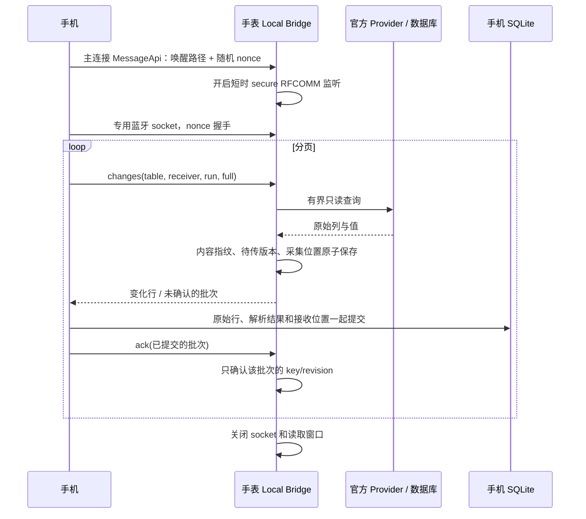

# 本地桥接协议

本文规定本应用手机端与手表 Local Bridge（中文名“本地桥接”）之间的私有协议：唤醒、专用蓝牙连接、分页传输、增量同步、可选的 root 运动采集和变更日志。它不是 Mobvoi 或 Google 的协议，只在两端都安装本应用时可用。数据的字段含义见[健康数据](health.md)和[私有运动数据库](fitness-database.md)。

## 1. 概述

手机 App 与手表 Local Bridge 使用相同的 applicationId `dev.ticbox.companion` 和同一把签名密钥。用户在手表上启用“允许手机读取”后，日常无需打开手表应用。手机主连接达到 `LINK_READY` 后自动发起采集；重新打开手机页面也会发起，进行中的调用合并为同一个任务。



健康数据不经过 GMS 的 sendData/sendMessage、Flow15、HTTP 或互联网。手表应用的清单中没有 INTERNET 权限。

## 2. 唤醒与握手

### 2.1 唤醒消息

唤醒消息通过主连接的直接 MessageApi 发送。路由 AppKey 是**本应用手机 APK 的真实包名和签名证书（DER）SHA-1 的小写十六进制**，不是官方伴侣的 AppKey。

```text
路径：/ticbox_local_health/wake
内容：{"version":1,"token":"<32 个随机字节的小写十六进制，共 64 个字符>"}
```

消息中不得放入健康数据。每次打开连接都生成新的 nonce；同一次唤醒窗口内的重试沿用同一个 nonce。

手表 `WearableListenerService` 只在以下条件同时满足时开启监听：路径正确、用户开关已启用、token 长度在 32 到 256 个字符之间、当前没有正在服务的窗口。手表不以 wake.version 拒绝请求；手机固定发送 1。条件不满足时不监听，手机不能把无响应当作成功的空页。

### 2.2 专用 RFCOMM

| 参数 | 值 |
|---|---|
| 服务名 | `TicBox Local Health` |
| UUID | `a701ba60-6fa4-4acb-b3e7-0d29b381f6ce` |
| 窗口 | 等待连接 25000 ms；握手后空闲 60000 ms，有活动的页会续期；单个窗口最长 300000 ms，各表共用 |
| 并发 | 同一时间一个窗口，窗口内按顺序处理请求 |
| 对端要求 | 蓝牙已配对（`BOND_BONDED`），并提供相同的 nonce |

手机最多尝试 10 次连接，前几次之间依次等待 300、150、150、300 ms，之后每次 500 ms，每次连接最多 2000 ms。建立 socket 后发送 hello，等待 ready。手表用常量时间比较 nonce。

```json
{"op":"hello","token":"<与唤醒消息相同的 nonce>"}
{"op":"ready","version":3,"tables":["data_session","data_point","fitness_record","fitness_point"]}
```

ready 的 version 为 3，表示同一连接提供持久的增量批次和入库确认，直到手机关闭连接。手机以 `op=ready` 判断握手完成，并要求 version ≥ 3；两端必须同时更新，不维护旧版本的协议。可选的 `tables` 列出手表当前启用的来源：开启 root 采集时为 `data_session / data_point / fitness_record / fitness_point`，关闭时 `fitness_summary` 代替两个完整运动表。手机跳过未列出的来源，不能把跳过记为成功的空页；缺少清单时按已知的表请求。

这一层绑定的是本次唤醒的 nonce 和已配对的蓝牙对端，不额外把 `MessageEvent.sourceNodeId` 与蓝牙 MAC 对应起来。密钥、nonce 和原始身份不写入日志。

手表蓝牙关闭、API 31+ 未获 `BLUETOOTH_CONNECT`、应用被禁用或强制停止、系统不投递消息时，桥接不可用。手机此时显示不可用并保留已入库的记录；被系统强制停止后无法保证还能被唤醒。

## 3. 帧与操作

每帧为 **4 字节大端长度前缀 + N 字节正文**，N 在 1 到 1048576 之间。这是内存和传输的边界，与健康数值无关。前缀的最高位为 0 时，正文是 UTF-8 JSON 对象；为 1 时，其余 31 位是 N，正文是这个 JSON 的 zlib 压缩数据，解压后同样不能超过 1048576 字节，否则整帧作废。只有请求带 `"compression":"zlib"` 时，它的回复才可能压缩；手表只压缩不小于 1 KB、且压缩后更小的正文。socket.read 不一定对齐帧边界：长度可能被拆开，多帧也可能连在一起，必须保留未消费的字节。手表在新帧开始前读到 EOF 时正常结束窗口，帧中途 EOF 视为中断；手机遇到任何 EOF 都报告传输异常，按已提交的位置重连续读。没有 TLS 或其他二进制包头。

### 3.1 changes

```json
{"op":"changes","table":"data_point","receiver":"<本地档案 ID>","run":"<本轮随机 ID>","full":false,"limit":1024}
```

table 只能是五个固定的逻辑表之一：`data_point / data_session / fitness_summary / fitness_record / fitness_point`。receiver 是手机持久的本地档案 ID，不是云账号；run 标识一次任务，重连时沿用，重启任务时可以接着手表上未完成的采集。`full=true` 强制重新读取全部启用的来源；手机没有该表的本地接收基线时也必须请求全量。可选的 `window` 是首次同步的时间窗（毫秒，见 [4.6](#46-首次同步的时间窗)），自动和普通同步都带，手动全量不带。可选的 `ack` 是这张表上一页的批次 ID，见 [3.2](#32-ack)；`compression` 见上文。旧版本的桥接忽略这三个字段。手机不传 SQL、URI、projection、路径或官方的分页位置。

回复（合成数据）：

```json
{
  "op":"changes","version":3,"table":"data_point","batch":"<批次 ID>",
  "rows":[
    {"id":"17","columns":{"_id":17,"values":"12.5","type":999,"time_from":1000,"time_to":2000},
     "storageTypes":{"_id":"integer","values":"string","type":"integer","time_from":"integer","time_to":"integer"},
     "bridgeEpoch":"<桥接库代际>","bridgeRevision":"5","bridgeKey":"17"}
  ],
  "nextId":"9","complete":false,"partial":false,"scannedRows":128,
  "providerVersion":"<实际包版本>"
}
```

| 字段 | 含义 |
|---|---|
| rows | 有变化、未确认或全量要求的完整原始行，最多 1024 条，还受单帧大小限制；保留未知字段。批次大小由手表决定，不看请求的 `limit`：1.0.5 起最多 1024 条，更早的版本最多 128 条 |
| batch | 手表上持久的批次 ID；确认前内容固定，重连时可以重放 |
| bridgeEpoch / bridgeRevision / bridgeKey | 桥接库的代际、交付版本和比较身份；不是官方的修改时间 |
| nextId | 批次进度，十进制 int64；**不是官方 ID，也不是 SPORT 的 occurrence** |
| complete | 本轮该来源的计划已结束，且所有待传项都在这一批中；手机仍需提交并确认 |
| partial | 有单元格或范围没读全，或源页无法继续；不能据此推断源端删除 |
| scannedRows | 本轮该来源累计读取的源行数，可能因范围重叠超过表的总行数 |
| providerVersion | 实际来源的版本，用于诊断，可能缺失；不作为固件白名单 |
| watchMillis | 手表处理这个请求所用的毫秒数（从读到请求到写出回复之前，不含预读），用于区分手表处理和蓝牙传输；`ack` 和 `journal` 的回复也带。旧版本没有这个字段 |
| queuedMillis | 请求到达手表后，等手表预读完上一页之后的行才开始处理的毫秒数。手机把它从传输时间中分出来，因为这段时间既不是蓝牙传输，也不是在处理这个请求。1.0.6 之前的版本没有这个字段 |
| deferredBefore | 只在 data_point 和 fitness_point 上：首次同步的时间窗把早于这个时间（epoch 毫秒）的行留在了手表上，直到一次手动全量。没有遗留时不带这个字段 |
| inlineAck | 这一批的 ACK 可以随同一张表的下一个 changes 请求发送，见 [3.2](#32-ack)。旧版本的桥接不带 |
| sourceAbsent | 行级字段；完整范围观察后发现该行已从来源消失，见第 4.4 节 |

每次 changes 按页读取（每页最多 1024 行），并原子保存观察结果、待传队列和采集位置；某页没有待传行时继续读下一页（最多连续 3 秒），然后生成持久批次。没有变化行时也可以发送带 batch 的空进度批次。单帧最大 1 MiB，行内容预留 8192 字节给元数据；放不下的行留待下一批。一行的 JSON 超过 960 KiB（1 MiB 减 64 KiB）时，读取时就去掉它最大的单元格，直到放得下，列名记入 `oversizedColumns`（见[健康数据](health.md#24-原始行的封装)），所以单行不会卡住后面的行；1.0.7 之前已经排进队列的超大行，组批时同样处理。日常同步读取的一页最多保留约 4M 字符的行内容，大行多时提前结束这一页，下一页接着读。

### 3.2 ack

手机把原始行、解析结果和接收位置提交之后发送：

```json
{"op":"ack","receiver":"<本地档案 ID>","table":"data_point","batch":"<批次 ID>"}
```

手表持久处理后回复：

```json
{"op":"ack","batch":"<同一批次 ID>","committed":true}
```

回复带 `inlineAck` 时，手机提交之后不单独发送 ACK，而是把批次 ID 放进同一张表下一个 changes 请求的 `ack` 字段：手表先在独立的事务里确认它，再处理这次读取，即使读取随后出错，确认也已生效。表的最后一页（`complete`）没有下一个请求，仍然单独确认；手机改读另一张表前，也先单独发出还没发出的确认。下一个请求没有发出时，手表重发这一批，手机幂等保存。

手表只清除这一批实际包含的 key/revision；旧的 ACK 不会清掉新版本或其他批次，重复的 ACK 是安全的。待传队列的 revision 只增不减，一批总是取队列里 revision 最小的那一段，之后入队或被替换的行 revision 都更大，所以手表记下每批最后一个 revision，确认时按它删除，不用逐行核对。ACK 没有持久处理或回复丢失时，重连后恢复；手机按相同的 epoch/revision 幂等保存。部分原始行可以尽量入库后确认，但手表不为它们记录完整的内容指纹，之后继续复查。手机事务失败时不确认。

### 3.3 错误

稳定的错误码：`unsupported_table`、`provider_missing`、`provider_denied`、`unsupported_schema`、`query_cancelled`、`row_exceeds_budget`、`query_failed`，以及 root 相关的 `root_not_enabled`、`root_unavailable`、`root_denied`、`fitness_database_missing`、`snapshot_failed`、`snapshot_timeout`（后两个也用于有界页读取失败或超时）。查询错误不能当作成功的空页。但日常同步中运动库文件或表不存在属于“没有数据”，返回完整的空页；`fitness_database_missing` 只用于手动导出。错误正文、SQL 参数和健康数值不跨协议传播。

窗口内的未知 op 被忽略，未知的 JSON 字段不导致拒绝。读取器对可读的行尽量处理，未读部分标 partial；无法推进时保留已有内容，并把该范围结束为部分结果。重复的 batch 可以带相同的 nextId，不能误判为游标停滞。部分范围不参与消失推断。

### 3.4 超时、重试与取消

手机每次打开连接最多 40 秒，每次 changes 或 ack 最多 30 秒；正常的活跃扫描不会因为整轮超过 40 秒而被切断，手表的空闲或总窗口超时可能更早关闭 socket。连接中断或超时后保留已提交的位置，重开窗口续读。连续 3 次连接或超时失败则结束该表；每成功提交一页就重置失败计数，重试前依次等待 1000、2000 ms。长扫描因此可以跨越多个窗口。

协议没有 `cancel` 操作。手机 `cancel()` 取消任务并关闭专用 socket，状态回到 `IDLE`、`reason=cancelled`，已提交的页不回滚。手表窗口到期时先关闭连接和监听，再取消 `CancellationSignal`。Provider 的 Binder 取消可能延迟，不能保证窗口到期时底层工作同时停止。旧窗口只关闭自己持有的资源。

## 4. 增量同步

手表状态保存在本应用的 `noBackupFilesDir/health-incremental.sqlite`，与官方数据库分开。增量同步不修改官方的 `synced`，不写官方业务表，也不经过任何云。

### 4.1 内容指纹与身份

`columns` 与 `storageTypes` 按字段名排序，递归规范化 JSON 后计算 SHA-256。整数不经浮点转换；NULL、缺列、空字符串，以及整数、浮点、文本、BLOB 都保持区分；CSV/JSON 文本保留原文。未知字段也参与比较，传输元数据不参与。

POINT 和私有运动表读取 Cursor 返回的所有列。SESSION 通过 data_point 载体查询 `pragma_table_info('data_session')` 得到当前的列，并以带标识符转义的有界只读投影读取新增列（见[健康数据](health.md#22-session8-列)）。schema 探测失败时保留已读字段并标记 `partial / schemaCoverage=known_fields_only`。观察到列集合变化后，安排整表重新比较。

原始行缺少部分单元格时不记为完整指纹；可读的内容照常入库，手机保留上次读到的缺失单元格的值，并保留 partial 和 unavailableColumns。带 `oversizedColumns` 的行每次读到的都一样，所以照常计算指纹、只发一次，也不让这次扫描算作不完整；手机同样保留这些单元格上次读到的值。实际读到的 NULL 可以覆盖旧值；之后完整的观察可以移除旧列。

记录身份：POINT 用 `_id`，SESSION 用不透明的 `columns.id`，SPORT 用 `[HASH, sourceOccurrence]`，私有运动表用 `_id`（POINT.RECORD_ID 关联 RECORD._id）。ID 被复用时比较新内容，不能因为“这个 ID 已确认过”就永久跳过。

**bridgeEpoch 是桥接库的代际，revision 是桥接观察到变化时生成的交付版本，二者都不是官方的修改时间或数据库代际。** 手机接收表缺少基线时强制全量；新的本地档案在手表上有独立的观察状态。手动全量不会清除其他 key 的归档。

### 4.2 读取调度

| 来源 | 每轮策略 |
|---|---|
| SESSION | 比较全部会话；重开、延长、合并、删除标记和物理消失都会重新观察 |
| 普通 POINT | 查大于已观察最大 ID 的新范围，再查最近一天和 `time_to<=0` 的范围；每小时最多一轮深度检查，把近期范围扩到三天，并轮查 256 条旧行 |
| 与睡眠相关的 POINT | 未结束或最近一天有变化的 SESSION，会把重点复查范围扩展到它的 time_from；老会话被重开也不会因为日期旧而被排除。全量采集第一次看到的会话不算有变化，否则换手机或导入后的一天里，每次检查都会被扩展到最老的会话，读遍整张表 |
| fitness_record | 比较全部训练摘要，包括进行中、收尾和 SYNCED/DELETED 的变化 |
| fitness_point | 新 ID 范围，加上最多 8 个到期训练的全部明细；每小时最多一轮深度检查，另加 256 条旧行轮查；父摘要不变也照常轮查 |
| fitness_summary | 比较 Provider 当前可见的所有摘要；权限被拒绝时保持不可用 |

训练明细在未结束、摘要变化或复查间隔到期时入选，按最久未检查的优先，避免固定的前 8 场训练占满名额。连续无变化时间隔从 5 分钟成倍延长，最长不超过一天，发现变化后恢复短间隔；部分读取不计入稳定次数。旧 ID 的轮查位置持久保存，到达表尾后从头开始，没有“超过某个日期就永久冻结”的规则。

同步的大部分时间花在重读很少变化的行上，所以深度检查按时间限频：自动同步每 5 分钟一轮，其中约十二分之一是深度检查，手动同步也受同样限制。普通 POINT 的修改主要发生在当天（例如心情），睡眠相关的点由上面的规则扩展范围，不受此限。代价是更老的行被修改、记账字段变化或只有老行才暴露的新增列，最多晚约一小时再加一个轮查周期才被发现。

时间只用于优先级；普通 POINT 没有可用的时间列时退回按 ID 范围比较。旧修改最终能否被发现取决于轮查持续完成，**不保证任意旧修改在下一轮就出现**。两次采集之间出现又消失的数据，无法通过只读轮询恢复。

### 4.2.1 预读

手表写出一个没有结束（非 `complete`、无错误）的 changes 回复后，在等下一个请求之前接着读源数据，直到待传队列比正在路上的这一批多出一页，或用完 3 秒的读取预算。这段时间里回复正在蓝牙上传输、手机正在入库，下一个请求到达时这一页的行已经在队列里。预读与按请求读取走同一套采集和持久化流程，被中断时进度同样保留；预读出错时不回复，留给下一个请求遇到并报告。`watchMillis` 只计请求处理的时间，不含预读。

### 4.3 运动库未变时跳过

启动 root helper 约需 1 秒，所以每轮先用一次 su 读取 `fitness.db` 和 `fitness.db-wal` 的修改时间与大小（不读内容，两张运动表共用一次结果）。与上次完整、无 partial 的采集开始前记录的值相同时，本轮跳过两张运动表，直接返回空批次；读取失败时按正常流程；全量同步不跳过。

### 4.4 源端消失与删除

显式的 deleted / DELETED 作为普通字段更新，并沿用默认查询的隐藏规则。物理消失只在一次固定 ID 或训练范围的完整观察完成后、对比已见的身份集合才能确定，此时发送 `sourceAbsent=true`；权限失败、部分页和未读范围不能产生这个标记。私有运动库文件或表不存在时按完整的空结果处理，已有的记录也会得到这个标记。

手机把 sourceAbsent 合并到旧的原始行上，保留原始健康值、解析结果和关联。它只表示来源当前看不到这一行，无法区分保留策略、删除、过滤或并发变化，也不等于用户要求删除归档。该行重新出现时正常更新并移除缺席标记。Provider 的跨页读取和 root 的跨页读取都不是全库原子快照，下一轮继续对账。

### 4.5 全量同步

手机“设置 → 诊断 → 立即全量同步数据库”调用 `sync(LocalHealthSyncMode.FULL)`：替换正在进行的增量任务，重复的全量请求合并。它逐表重新读取全部可用记录并发送完整的行，绕过新 ID、近期、轮查和训练退避等优化；仍然分页，仍然等手机事务提交后才确认。它不是 `.db` 文件传输，不读取未授权或未知的数据库，不触发云上传，也不清空已有归档。

### 4.6 首次同步的时间窗

一个本地档案第一次从手表读取 data_point 和 fitness_point 时，可能要读几万行。手机在每次非全量的 `changes` 里带 `window`（3 天），手表只在这张表对该 receiver 还没有基线、且以前没有为它观察过任何行（或者以前的时间窗已经留下了旧行）时使用它：

1. 先用一页只取一行的查询判断有没有早于 `now - window` 的行（`time_to` / `TIMESTAMP` 大于 0 且早于边界），这一页的行不观察也不发送。
2. 再按 `time_to>=边界 OR time_to<=0`（fitness_point 用 TIMESTAMP）读取并发送窗口内的行，完成后建立基线。
3. 第 1 步有旧行时，在桥接库的 metadata 里记下边界，之后每个批次的回复都带 `deferredBefore`；没有旧行时不记，窗口内的读取就是全部。

记下边界后，常规检查不能把旧行一点点补过来：近期范围的起点不早于边界；轮查从已观察到的最小 ID 开始；fitness_point 跳过结束时间早于边界的训练；日志的每日对账、日志重置和列变化后的整表比较也从最小 ID 开始。边界只记录在手表上，SESSION、fitness_record 和 fitness_summary 不受时间窗影响，照常整表比较。

手动全量（不带 `window`，并重新发送全部行）完整结束后清除边界，此后的回复不再带 `deferredBefore`。手机的同步状态 `deferredBeforeMillis` 取各表最近一次回复里的最小值，健康页据此显示横幅和“全部同步”。这个值只在内存中，应用重启后要等下一轮同步读到这两张表才重新出现。

## 5. root 运动采集

普通 UID 读不到运动明细（见[健康数据](health.md#23-sportfitness_summary-的-10-列)）。手表可以单独开启“读取完整运动记录（root）”，默认关闭，需要 Magisk 授权；未授权时无法开启。手机不需要 root。它不需要 LSPosed，不修改官方 APK、签名或 Provider 权限。

每个请求通过 `su --mount-master -c` 启动本应用 APK 中的 `FitnessPageMain`（系统 `app_process`），只加载本应用的代码和系统 SQLite，不加载官方应用，也不要求设备上有 sqlite3。来源固定为 `com.mobvoi.wear.fitness.at` 当前数据目录下的 `databases/fitness.db`；不接受手机传入的路径、SQL 或 projection。

所有 root helper（运动分页、运动库检查、手动导出的快照和变更日志）都必须以 `--mount-master` 在全局挂载空间中运行。不加时 su 沿用 Local Bridge 自己的挂载空间，Android 11 起的应用数据隔离会让 root 也看不到其他应用的数据目录：运动库被当成“没有数据”返回空页，变更日志报 `journal_database_missing`。

helper 以 `OPEN_READONLY | NO_LOCALIZED_COLLATORS` 打开数据库，只查询固定的 RECORD / POINT 有界页，保留所有可读的列和类型；每页最多 1024 行（按请求的 `limit`）并预读一行，按 `_id` 数字分页，训练范围使用 RECORD_ID。结果写入普通 UID 预先创建的私有临时 JSON，普通 UID 比较内容并持久排队后通过蓝牙发送，随后删除临时文件。不复制整个数据库，不修改 SYNCED/DELETED，不停止官方服务，不修改官方目录的权限和属主。

每页的只读视图包含已提交的 WAL；跨页、跨表不构成原子快照，等待蓝牙时也不持有事务。helper 截止 20 秒，su 等待最多 25 秒。原始数据和 SQL 错误正文不进入状态或日志。SQLite 可能使用读锁和共享内存，不能声称完全没有元数据开销。

| 线上 table | 手机 kind | sourceName |
|---|---|---|
| `fitness_record` | `FITNESS_RECORD` | `sqlite://com.mobvoi.wear.fitness.at/fitness.db/RECORD` |
| `fitness_point` | `FITNESS_POINT` | `sqlite://com.mobvoi.wear.fitness.at/fitness.db/POINT` |

RECORD 的 HASH 不是分页键；POINT.RECORD_ID 指向 RECORD._id。原始 `columns` 保留大小写、存储类型、BLOB 和未知字段。私有运动的失败不影响普通健康表，也不覆盖成成功的空页。手表从未记录过运动时，库文件或表可能不存在，日常同步返回完整的空结果。

手动 JSON 导出另用 `FitnessSnapshotMain` 通过 `VACUUM INTO` 建立两表一致的只读副本，导出后清理；这不是日常同步的前置步骤。

## 6. 变更日志（可选，需要 root）

轮询需要反复重读很少变化的行。启用变更日志后，日常同步按日志中的键回读，没有变化时跳过普通的行扫描。它通过 `services.localHealth.setJournalEnabled()` 显式启用，配对、重连和普通同步都不会安装它。实现见 [AtomicHealthJournal.kt](../../android/watch/healthbridge/src/main/kotlin/dev/ticbox/companion/healthbridge/AtomicHealthJournal.kt)、[HealthJournalProfiles.kt](../../android/watch/healthbridge/src/main/kotlin/dev/ticbox/companion/healthbridge/HealthJournalProfiles.kt) 、[RootHealthJournalReader.kt](../../android/watch/healthbridge/src/main/kotlin/dev/ticbox/companion/healthbridge/RootHealthJournalReader.kt)、[HealthJournalRead.kt](../../android/watch/healthbridge/src/main/kotlin/dev/ticbox/companion/healthbridge/HealthJournalRead.kt) 和 [HealthModuleJournal.kt](../../android/watch/healthbridge/src/main/kotlin/dev/ticbox/companion/healthbridge/HealthModuleJournal.kt)。

### 6.1 为什么用同库触发器

在官方进程里 hook DAO 或 SQLite 回调，再把变化写进另一个文件，无法与官方事务一起原子提交：官方提交后、日志写入前进程被杀，就会漏记；`SQLiteTransactionListener.onCommit` 在真正 COMMIT 之前调用；`sqlite3_update_hook` 等回调每个连接只有一个槽位，会替换官方的回调，也不是提交确认。Room 自带的 invalidation tracker 只记表级的失效位，不是持久的行日志。

因此日志用 SQLite 触发器写在官方数据库内部：日志记录与官方的修改属于同一个事务，随事务或 savepoint 一起提交或回滚，不需要另一个文件，也不替换 Room 的 TEMP 触发器或 SQLite hook。

### 6.2 API

```kotlin
services.localHealth.journalStatus(LocalHealthJournalSource.HEALTH)
services.localHealth.setJournalEnabled(LocalHealthJournalSource.HEALTH, true)
services.localHealth.setJournalEnabled(LocalHealthJournalSource.FITNESS, true)
services.localHealth.setJournalEnabled(LocalHealthJournalSource.HEALTH, false)
```

复用本地蓝牙健康通道，要求手表已允许读取并授予 root。两个固定来源 `health_common.db` 和 `fitness.db` 分别启用，不声称跨文件原子。没有任意路径、表名、SQL 或反射入口。同步进行中返回 `journal_sync_in_progress`，避免打开第二个读取窗口；手表应用版本过旧时返回 `journal_bridge_update_required`。操作绑定当前手表和连接代际。

`installed=null` 表示无法观察，不能当作未安装。写操作的回复丢失时不得自动重试，应先查询状态。安装可以幂等查询，但不会静默修补缺失的触发器：缺失期间可能已经漏记，必须移除后重新启用并重建基线。手机接口自身 90 秒超时时抛出 `LocalHealthJournalException("journal_operation_unconfirmed")`，不能据此判断安装或移除没有提交；调用方主动取消时照常传播取消异常；两者都不自动重放。

禁用时先持久停止使用日志，再移除；只有 `installed=false` 且没有错误时才算确认移除。root 被撤销或超时可能留下触发器，恢复 root 后可以显式重试。移除只删除可识别的自有对象，在同一事务中按触发器、自有索引、日志表的顺序删除，不删除健康数据，不修改官方的索引或同步标记。手表上的官方应用升级到未识别的版本后，仍允许受限的移除，但安装和读取必须通过精确准入。禁用或卸载 Magisk 模块不会自动删除数据库中的日志，需要单独调用移除。

### 6.3 记录的内容

每个数据库使用独立的命名空间 `ticwatch_journal_v1_`（这一前缀会长期留在手表的数据库中，为保持兼容不随应用改名），包含元数据表、事件表、pending 索引和业务触发器。健康库覆盖 `data_point`、`data_session`，`data_source` 变化时两表都需要重建基线；运动库覆盖 `RECORD`、`POINT`。

SQLite 的 OR IGNORE、OR FAIL 和其他触发器可能中断 AFTER 触发器而保留部分修改，所以 BEFORE 先写候选，AFTER 再补自动生成的 ID。未完成、嵌套关系不确定、无法无损保存键，或非主键 UNIQUE 可能引发 REPLACE 的隐式删除时，保守地整表回读。候选可以多报；不能单凭 DELETE 候选生成删除，必须回读确认当前确实缺席。

日志只记录序号、固定的表类型、操作、新旧键和覆盖标志，不含健康值、SQL 参数、账号或 GPS。每个库最多 8192 条，键按字节限长；裁剪和下限在原事务中持久推进。消费游标落后于下限时必须重建基线；容量满本身不阻止写入。只记键的日志无法恢复两次观察之间插入又删除的中间值，不是完整的数值审计。

严格的原子记录也有代价：日志的 SQL、存储或元数据出错时，可能连带阻止官方的写入。不能同时承诺“日志失效时官方写入照常提交”和“日志绝不漏记”，所以提供显式启用和移除，而不是静默降级后宣称无损。

### 6.4 准入与 root 边界

启用前核对实际的包名、UID、版本名和版本号，以及完整 APK 的 SHA-256；目前精确支持 TicHealth 5.5.0-3292.2931、5.6.0-3234.2686 和 TicFitness 5.5.0-2536.2932（白名单在代码中）。随后校验 user_version、Room hash、目标表的完整结构、外键、约束、索引和永久触发器。同一版本中已确认的结构变体（HASH UNIQUE、POINT AUTOINCREMENT）单独识别；更早或未确认的结构拒绝启用，退回独立读取。不通过修改 Room hash 或 user_version 绕过验证。

数据目录、数据库和已有的辅助文件必须是预期 UID 拥有的普通文件，拒绝符号链接。一次性的 su helper 先验证来源，打开 Local Bridge 自己的请求和回复文件，再不可逆地降到官方应用的 UID/GID 后打开数据库，避免新的 WAL/SHM 归 root 所有。helper 在创建系统 context 之前先打开一个内存数据库：进程里有 Application 时，SQLite 第一次打开数据库会经它读取一项全局设置，而系统 context 的包名 `android` 与 root 和官方应用的 UID 都不符，这次读取会被系统拒绝，之后的每次打开都会失败；没有 Application 时 SQLite 跳过这项设置，使用默认值。写连接使用观察到的 journal 模式，辅助连接自身使用 FULL 同步；不修改官方连接的 synchronous、recursive_triggers 或 checkpoint 配置。helper 截止 20 秒，su 等待 25 秒；等待蓝牙时不持有源事务，消费时只读打开，不自动修复。

### 6.5 消费与恢复

```text
官方操作与同库候选一起提交
 → Local Bridge 读取固定上限内的日志，回读完整行或确认当前缺席
 → Local Bridge 同一事务：指纹 + 待传队列 + 源消费序号
 → 蓝牙批次 → 手机事务提交 → key/revision ACK
```

没有变化时跳过普通行扫描；有变化时按需要的键回读，旧 ID 不受日期窗口限制。回读拿到更新的版本也是安全的，之后的日志在下一轮处理。每个手机档案、每张表独立保存 epoch、文件代际和序号，与交付 epoch 分开；新的接收方不继承旧游标。

首次启用、源库重建或替换、schema 或触发器不符、日志截断或倒退、手动全量，以及每天一次的独立审计，都重新核对完整的源范围。完整读取与强制重传分开记录：首次接收和手动全量重传所有行；日常审计和缺口修复只发送指纹变化、新增和确认缺失的行。基线只确认开始前的日志头，扫描期间提交的变化仍待消费；部分基线不推进游标。基线完成时不再读一次日志窗口：下一轮开始时总会拿当前窗口核对游标，日志在这期间被截断、重建或换了代际时，就从那里重新建立基线。

root 或日志不可用时，保留旧的日志游标，先完成一次独立的完整扫描；成功后持久标记本轮降级已核对，之后按普通的轮询调度采集，不会每次都重扫、重传整表。partial 或失败不标记成功；标记不依赖手机的 ACK，也不清除已有的待传队列。日志恢复并成功消费或确认空窗口后清除该标记；再次失去日志时必须重新核对，不能凭文件时间相同证明日志连续。

待传队列持久后即可接管源序号，不必等手机在线。Local Bridge 的事务失败不推进；ACK 丢失时重放批次，旧 ACK 不清除新的 revision；sourceAbsent 仍保留手机上的历史。

### 6.6 读取

每轮同步每个来源只读一次：同一次读取带回日志窗口，以及本接收方每张表在游标之后的一页事件和对应的行（每页最多 128 个事件，行放不下时减半；整个回复最多 1 MiB，放不下的表之后单独读页）。窗口不再包含的游标不带页，那张表照常重建基线。schema 校验只做一次，包含在文件代际的指纹计算里。

**健康库经进程内模块读取。** 装了[进程内模块](monitoring-settings.md#52-进程内模块)时，读取在官方健康应用的进程里完成，不启动 root 辅助进程。应用之间按 Android 的 SELinux 策略只能用 Binder 通信，不能直接连到另一个应用的 Unix socket，所以这条路走 Binder：

1. 模块每次启动生成 128 位随机令牌，写进官方应用私有目录的 `no_backup/ticbox-health-token`，只有属主可读。Local Bridge 用 root 读出令牌，每个进程读一次。
2. Local Bridge 向 `com.mobvoi.wear.health.at` 发有序广播 `dev.ticbox.companion.healthmodule.JOURNAL`，附上令牌。令牌相符时，模块在结果的 extras 里交回 Binder（结果码 1）；不符时结果码为 2。没有模块时，广播立刻以 0 结束，不用等待。
3. 每次查询是一次 Binder 调用：事务码为 `FIRST_CALL_TRANSACTION`，请求和回复都是 UTF-8 JSON 的字节数组，请求都带令牌。操作有两个：`journal_describe` 返回包名、版本号、版本名、APK 摘要，以及数据库文件的 device 和 inode；`journal_query` 执行一条 SQL，参数只能是字符串。
4. 模块只接受单条 SELECT、WITH，以及校验用到的 PRAGMA（user_version、table_xinfo、foreign_key_list、index_list、index_xinfo），PRAGMA 不能带赋值。连接以 `OPEN_READONLY | NO_LOCALIZED_COLLATORS` 打开，文件被替换后重新打开，空闲 30 秒后关闭；每条查询 5 秒超时。
5. 单元格带存储类型：`i` 整数、`f` 浮点、`s` 文本、`b` Base64 的 BLOB，或 null。Local Bridge 据此还原出与直接读文件相同的游标。一个进程的 Binder 缓冲只有约 1 MB，所以回复最多 256 KiB；按键取行时每次最多 128 个键，回复过大就分成两半再查；单独一行就超过 256 KiB 时，这次读取改用辅助进程。

所有检查都在 Local Bridge 里完成，用的是辅助进程读文件时的同一套代码：版本白名单、schema、日志命名空间和元数据，以及文件代际（来源、版本名、device、inode、schema 指纹）。所以两条路径算出的代际相同，游标在两条路径间通用，换路径不会重建基线。读取前后各取一次 device 和 inode，不同就报 `journal_source_replaced`。模块没有加载、令牌读不到、版本不在白名单或读取出错时，改用 root 辅助进程。开启和关闭日志总是由辅助进程完成。

**运动库仍由 root 辅助进程读取**，模块不在运动应用里。开着运动日志时，每轮先用 su 和 stat 取运动库及其 WAL 的修改时间和大小，与不开日志时的检查相同。和上次读窗口之前取的值一样，就沿用上次的窗口，不启动辅助进程；游标已在窗口头的表，这一轮就不用读。stat 在读窗口之前取，所以读窗口期间发生的写入，下一轮会表现为变化。开启或关闭日志会清除保存的窗口。

## 7. 手动 JSON 导出

手表 Local Bridge 的设置页（以及 debug 包的检查页）提供“导出健康 JSON”，也可以通过 ADB 打开：

```bash
adb shell am start -W -n dev.ticbox.companion/dev.ticbox.companion.healthbridge.HealthExportActivity
```

打开页面不会查询数据；用户选择范围并点击“开始导出”后，才调用后台同步使用的同一个读取器。页面不接收外部 Intent 传入的 SQL、URI 或自动开始指令。文件通过 `MediaStore.Downloads` 保存到手表的 `Download/TicBox/`，不需要 `run-as`、root 或存储权限（完整运动来源仍需开启 root 采集）；不上传，不修改官方同步标记，也不删除官方数据。

选项：

- 默认选择 POINT 和 SESSION；SPORT 可以单独勾选；完整运动的 RECORD 和 POINT 默认不勾选，需要先开启 root 采集。某个来源权限被拒绝时写入该来源的结果，不影响其他来源。
- 每个来源可以按类型编号过滤，留空表示全部。例如血氧为 POINT 28，睡眠会话为 SESSION 100，睡眠分期为 POINT 2。SPORT 使用另一套编号。
- 开始和结束时间可以留空，支持 epoch 毫秒、`2025-01-02`、`2025-01-02 08:30` 或带时区偏移的 ISO 时间；没有偏移时使用手表时区，结束只填日期时包含当天。按区间重叠过滤，不截断原始区间；无法解释的类型或时间元数据保留，并计入 `unresolvedFilterRows`。
- 每个来源默认最多 200 条，可选 1 到 5000。顺序是读取器的游标顺序，**不是最新的 N 条**。另有每个来源 50000 行扫描、60 秒和 8 MiB 行内容的预算。
- 默认对 `wwid / device_id / ACCOUNT_ID / DEVICE_ID / HASH` 做本次导出内一致的匿名替换，保留同一导出中的关联，不导出替换用的盐；不同导出之间无法对应。可以显式关闭。行 ID、健康数值和时间始终包含在内；完整运动的 POINT 还包含 GPS 位置，开启匿名化也不会移除路线，分享前必须检查位置和时间。

“睡眠与血氧样本”预设会选择 POINT 和 SESSION，并填入 POINT `2,28`、SESSION `100`；需要对应的心率、呼吸率和皮温时，可以加入 `1,38,42`。

导出格式为 `watch-health-json-export-v1`。顶层包括唯一的 `runId`、手表的导出时间和时区、选择条件、预算、匿名化说明、所选来源的 `tables` 和汇总 `summary`。每个来源包含 `table / sourceName / provider`、Provider 的 `queryUri` 或私有表的 `access=root_readonly_sqlite_snapshot`、原始 `rows` 和 `result`；Provider 还会尽量记录权限的 protectionLevel 以及本应用是否获得该权限。每行保留读取器的 `id / columns / storageTypes`、未知列、BLOB 和 partial 信息；SPORT 还保留 `sourceOccurrence`。

`result` 包括 `status / complete / partialRows / reason`、读取页数、读取器返回的行数、实际检查的行数、导出行数、被过滤的行数和无法确定过滤归属的行数。status 为 `complete / partial / failed / cancelled`；`row_limit / scan_limit / byte_limit / deadline` 区分截断原因；所有来源都失败时 summary 为 failed，成功与失败混合时为 partial。成功的空表为 complete 且零行；取消或部分失败仍保存已取得的行，并写成合法的 JSON。

每次导出新建文件，写入、落盘和关闭完成前通过 `IS_PENDING` 保持未公开，成功后才发布；失败时尝试删除未完成的文件，保留以前的导出。离开或重建页面会请求取消，未完成的文件直接删除。同一进程同时只允许一个导出任务。

## 8. 勿扰同步

手机的勿扰状态单向同步到手表，路径为 `/ticbox_dnd/state`，使用本应用的 AppKey，由 Local Bridge 应用到手表系统。需要在手表上授予 Local Bridge 勿扰访问权限（可通过 ADB 执行 `cmd notification allow_dnd dev.ticbox.companion`）。细节见[工具箱协议](toolbox.md)。

## 9. 诊断

手机记录模式、阶段、累计提交的批次和行数、每批条数、手表累计读取的源行数，以及 read、save、ack、retry 等阶段的耗时；手表日志记录页和行、扫描数、partial 和稳定错误码。同一任务内的重放只计一次。手机日志在 `no_backup/protocol-diagnostics/`，手表的 Logcat tag 为 `TicBoxHealthBridge`。日志不包含健康值、GPS、nonce、账号或 SQL 参数。

手表在每个回复里带 `watchMillis` 时，手机把 read 拆成 `watch`（手表处理）和 `transfer`（其余时间：请求和回复的蓝牙传输、手表序列化和压缩、手机解压和解析），并累计每页收到的字节数。每轮结束后，手机为每张表写一条 `run_timing` 诊断（各阶段的毫秒数、次数和字节数，压缩时为压缩后的大小，不含健康数据），另有一条带总耗时的汇总。

变更日志的每次操作（读状态、开启、关闭）结束后，手机写一条 `journal_result` 诊断：来源、操作、结果（`ok`、稳定的错误码、手机等满 90 秒的 `phone_timeout` 或异常类型）和耗时。手表的 root 辅助进程遇到非预期异常时，在回复里附上失败的步骤（sqlite、context、verify、stat、uid、open、validate 或操作名）、异常类型和抛出位置（最多 4 个“类.方法”，跳过 Binder 转发的帧），Local Bridge 把它们连同超时和退出码写入 `TicBoxHealthBridge` 日志；异常消息可能含有 SQL 或数据，不记录。

手表每读一次变更日志，记录走了哪条路：`Journal read through the module` 带查询次数和毫秒数，`Journal helper finished` 带操作和毫秒数，`Journal window unchanged` 表示运动库没变、沿用了上次的窗口。模块那条路失败时记录 `Journal read through the module failed` 和稳定的原因码，`Health module journal not available` 表示模块没有交回 Binder（没装模块，或令牌不符）。

手表每开始一次新的采集，记录一行 `Capture planned`：表、是否全量、是否重发、是否走变更日志，以及计划的范围种类（new、recent、deep、workout、all、probe），不含 ID 或时间。近期范围被未结束或最近一天有变化的会话向前扩展时，记录这样的会话数（`Recent range widened`）。每次预读结束记录一行 `Read-ahead`：读取的源行数、待传行数、采集是否结束和耗时。`Local changes sent`（每个 changes 回复一行）和 `Read-ahead` 还把耗时拆成读源数据（`source`）、算行的指纹（`hash`）、写本地账本（`ledger`）和组装批次（`pack`，只有回复有）各用的毫秒数；`Local changes sent` 的 `queued` 是请求等预读的时间。
