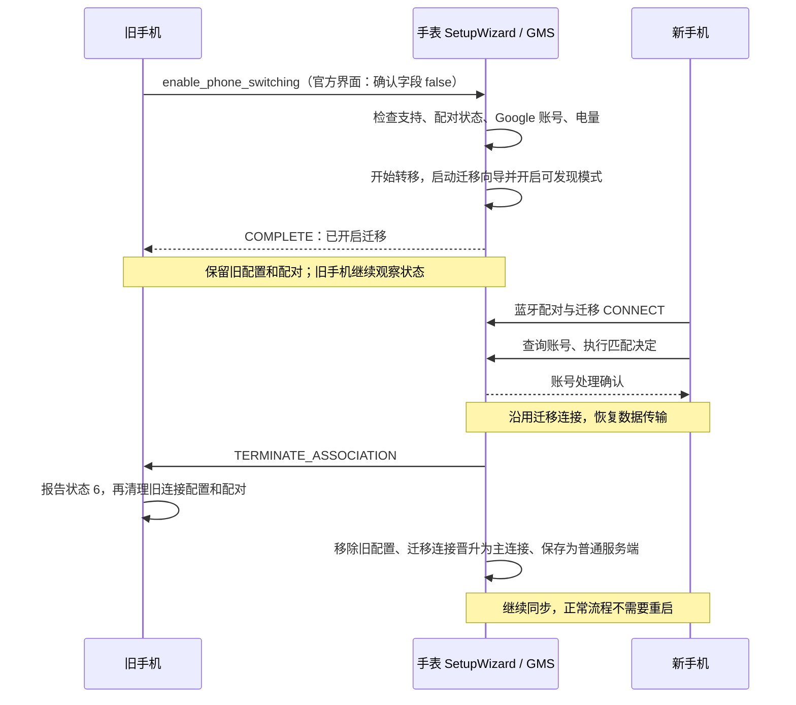

# 官方换手机流程

官方 Mobvoi Health 可以通过蓝牙发起“转移手表”，不需要 USB。它用专用 RPC 开启迁移，保留旧连接配置，等新手机完成迁移后才清理旧连接。本文说明这一流程的完整时序、几个入口的区别，以及迁移后手表不再接受连接的已知问题。消息格式见[解除配对与迁移](pairing-unlink.md#5-转移到新手机)。

厂商在 [Wear OS 4 升级公告](https://www.mobvoi.com/ge/blog/Wear-OS-4-Upgrade-and-Enhanced-Functionality-for-TicWatch-Pro-5-Series?_id=66d6bfb9a743410012e83485)中把“换手机无需恢复出厂”列为 Wear OS 4 的功能。Wear OS 3.5 不支持保留数据换手机。

## 1. 官方手机入口

官方 App 的“设备设置 → 系统 → 转移”页面点击开始后，直接调用迁移 RPC；在此之前不发送 `companion_unpaired`，也不删除配对或连接配置。

该选项默认隐藏，只有 SDK 报告可用时才显示：依次检查目标手表的 `phone_switching` 能力、手机 GMS 的换手机开关、手表上的 Google 账号数量（为 0 时报告 `NO_GOOGLE_ACCOUNT`）。

官方界面实际发送 `require_user_confirmation=false`（`08 00`）。SDK 支持的“在手表上再次确认”分支不是该界面的必经步骤：

| 调用方式 | 手表行为 | 手机得到的结果 |
|---|---|---|
| 官方界面，确认字段 false | 通过前提检查后直接开始转移 | RPC 返回 `COMPLETE` 表示已开启迁移，然后观察连接状态 |
| SDK 的需要确认分支，字段 true | 打开系统确认页（`setTimer=true`），等待接受或拒绝 | 先返回 `PENDING`，再由回复消息给出结果；手机最多等 90 秒 |

## 2. 三方共同完成的流程

图中各步骤之间没有跨进程的原子顺序：旧手机收到终止消息、旧手机清理完成、手表切换监听器可能交错发生。

### 2.1 开启迁移时保留旧连接

无论由 RPC 还是系统设置页触发，开始转移都执行：

1. 启用设置向导的相关组件。
2. 把 Global `device_provisioned`、Secure `user_setup_complete`、System `setup_wizard_has_run` 置为 0，把 Global `phone_switching_status` 置为 1。
3. 启动设置向导。
4. 向导的迁移分支进入可发现状态，把 `phone_switching_status` 推进到 5，等待新手机。

蓝牙配对成功后状态变为 6；WCS 据此注册迁移配置并推进到 8。这里的 `phone_switching_status=6` 与 GMS 连接事件 `ASSOCIATION_TERMINATED=6` 属于不同的状态域。

这些步骤不删除旧连接配置和蓝牙配对，也不清除健康数据库；向导的清理入口会检查是否正在迁移。进入设置界面和 provision 标志变化不代表应用数据被清除。它们也不直接修改 GMS 记录的客户端节点。

无重置解除配对（`companion_unpaired`，`skipWipe=true`）则会移除 WCS 可见的所有连接配置和旧伴侣配对。**先解除配对再打开迁移页，会破坏官方流程依赖的前置状态**，不能把它当作迁移的第一步。

### 2.2 账号确认后沿用已有连接

新手机的 GMS 使用迁移 CONNECT 和控制面的账号匹配。账号为空时：收到查询后回复空列表，收到空的处理决定后发送确认，不删除任何账号。非空账号的匹配和删除决定是另一套流程。

手表在账号匹配成功后，把当前配置的 `Migrating` 改为 false 并保存，然后用已有的传输写入方恢复数据面；新手机的 GMS 同样复用已有的写入方。两端都不要求新手机关闭迁移连接、另建普通 RFCOMM。

随后手表通知旧节点终止关联，清理旧节点的配置和配对，并把当前迁移配置保存为普通服务端。运行中的迁移服务器有专门的“用迁移连接替换主连接”分支：旧主配置被移除时，迁移配置和连接接管主槽位。最后的数据库写入本身不会重新注册监听器。

### 2.3 区分开启结果、终止旧关联与 CDM 清理

RPC 成功后，旧手机 SDK 发布 `STARTED`，按手表地址监听 GMS 的连接状态：-9 对应 `ABORTED`，6（`ASSOCIATION_TERMINATED`）对应 `COMPLETED`。手表 RPC 的 `COMPLETE` 只是“已开启迁移”，与最终状态不是同一个确认。

收到状态 6 时，官方 SDK 只**停止 CDM 的设备在场观察**，并不删除 CDM 关联；删除关联由另一个启动时的对账流程完成：它比较 CDM 关联与 GMS 配置，对不一致的关联调用 `disassociate`。旧手机的 GMS 先发布状态 6，再移除连接配置并调用 `removeBond`，所以状态 6 也不代表已经观察到 `BOND_NONE`。

## 3. 各入口的区别

| 入口 | 确认与执行位置 | 条件与结果 |
|---|---|---|
| 官方手机界面（确认字段 false） | 手机显示转移页面；手表通过检查后直接开始转移 | 手表要求有 Google 账号；RPC 返回后继续监听迁移状态 |
| SDK 的需要确认分支（字段 true） | 手表包装页打开系统确认页，接受后由包装页开始转移 | 同样要求 Google 账号；支持 `PENDING` 和异步结果 |
| 手表设置菜单 | 手表系统确认页直接开始转移 | 菜单的显示受 Google 账号等条件限制 |
| 直接启动 `WATCH_TRANSFER` Intent（包括 ADB） | 同一个系统确认页，默认 `setTimer=false`，接受后页面直接开始转移 | 页面本身不检查账号；启动成功只说明页面已打开 |
| 本应用“在手表上打开迁移流程” | 通过蓝牙 Remote Intent 打开同一个确认页 | 需要现有连接；报告 `REMOTE_UI_OPENED`，未实现官方 SDK 的完整状态观察 |

RPC 在检查 `require_user_confirmation` 之前就检查账号，因此把字段改为 false 也不能绕过。手表没有 Google 账号时，设置菜单可能被隐藏，但直接启动页面仍可进入，所以本应用使用显式 Intent。

直接启动时不要携带 `setTimer=true`：这个值使确认页接受后只返回结果，由包装页接着开始转移；没有包装页的普通启动不能用它模拟官方 RPC。

本应用的“更换绑定的手机”页先检查手表：HomeInfo 的 `WEAR_ANDROID_SDK_VERSION` 为 30（Wear OS 3.5）时不提供“在手表上打开迁移流程”，检查完成前同样不提供；未上报该字段时不拦截。实现见 [PhoneTransferScreen](../../android/ui/src/main/kotlin/dev/ticbox/companion/ui/connection/PhoneTransferScreen.kt)、[DeviceSettingsEngine](../../android/core/engine/src/main/kotlin/dev/ticbox/companion/engine/settings/DeviceSettingsEngine.kt) 和 [DeviceSettings](../../android/core/api/src/main/kotlin/dev/ticbox/companion/api/DeviceSettings.kt)。

## 4. 本应用的时序

- 账号操作 4 有效时，把当前连接作为数据面的交接点，沿用同一条物理连接、解码器、分片组装器和串行写入方。确认前已读到的业务帧在 CONNECT 阶段的预算内暂存，确认所在批次的控制消息处理完后才启动业务，并按原顺序交出；同一批读到的确认和后续数据都不丢弃。之后真实断线时才按普通 CONNECT 重连，不为验证迁移状态而主动断开。失败、取消、损坏或账号非空时停止协商，不删除账号。
- 迁移入口通过蓝牙打开系统确认页，保留旧配对和配置，不串联无重置解除配对。
- 收到 `TERMINATE_ASSOCIATION` 时，引擎报告独立的终止失败并停止重试；服务持久暂停该手表的自动恢复，停止 CDM 在场观察，但保留所选手表、身份、健康库和 CDM 关联。迟到的旧会话失败不会暂停新会话，在场或蓝牙事件也不会自动恢复已终止的关联。
- 迁移完成后，用户可以在“更换绑定的手机”页手动清除这部手机上的配对记录（`clearLocalPairing`）：不向手表发送任何内容，只删除本机的蓝牙配对和 CDM 关联并停止重连，手机健康库和身份不受影响。
- CONNECT 诊断只记录“旧节点是否等于本机节点”的布尔值，不输出节点身份。官方 SDK 受 Google 账号限制的状态观察未实现；系统确认页打开和账号操作 4 都不标记为整次迁移完成。

同一部手机保留客户端身份后重新添加同一块手表时，旧节点与新节点相同；手表按节点 ID 查找旧配置，可能命中新的迁移配置。这是一条可能的异常路径，尚未确认。

## 5. 已知问题：迁移后手表不接受连接

### 5.1 现象

| 状态 | 故障时 | 重启手表后 |
|---|---|---|
| `migrationIsActive` | `false` | `false` |
| `mainConfig` | 空，无连接、未运行 | 普通 `server`，`Migrating=false`，`IsConnected=true`，运行中 |
| `migratingConfig` | 普通 `server`，`Migrating=false`，`IsConnected=false`，仍有连接对象且标记运行中 | 空 |
| 监听线程 | `shouldAccept=false / isWaiting=true / isClosed=false` | 相同 |
| 手机主连接 | RFCOMM 打开，发出 CONNECT，收到 0 字节，15 秒超时 | 恢复 |

`shouldAccept=false / isWaiting=true` 本身不是故障特征：正常工作时已有主连接，监听器同样可以处于等待状态。异常是**普通配置仍占着迁移槽位，主槽位为空**，同时 CONNECT 没有回复。也出现过另一种状态：数据库已保存普通服务端，但运行时的主槽位和迁移槽位都为空。两者都是持久配置与运行时注册不一致。

### 5.2 机制

手表 GMS 的迁移服务器有两套独立的槽位：主槽位（配置、连接、运行标记）和迁移槽位。注册时按配置对象上可变的 `Migrating` 字段选择槽位。

1. 新手机的迁移连接运行在迁移槽位，`Migrating=true`。
2. 账号处理成功后，`Migrating` 被原地改为 false。已有的物理连接继续承载数据，此时看起来一切正常。
3. 旧主配置如果已被提前移除，就不会触发“用迁移连接替换主连接”；数据库里是普通服务端，内存中的对象却仍在迁移槽位。
4. 手机进程被终止（例如覆盖安装）或连接自然断开，连接线程退出。
5. 线程退出时按 `Migrating` 的**当前值**（false）选择清理的槽位，于是清理了主槽位，留下失效的迁移槽位，并且仍标记为运行中。
6. 新的连接按已保存的 `Migrating=false` 选择主配置，而主配置为空，协议处理线程不会启动；监听器也没有空闲槽位。手机能打开 RFCOMM，但一直收不到 CONNECT。

“先打开手表上的转移页，再解除旧手机配对”会提前移除旧主配置，正好触发第 3 步。

正常重启手表时，GMS 初始化会重新读取保存的连接配置，并按 `Migrating=false` 注册到主槽位，连接因此恢复。主传输的 CONNECT 失败时，Local Bridge 的独立连接（UUID `a701ba60-6fa4-4acb-b3e7-0d29b381f6ce`）还没有开始，所以更新 Local Bridge 无法修复 GMS 的内存注册。

### 5.3 处理建议

- 换手机时保留旧配对和主配置，直到新手机完成迁移、由手表清理旧节点。打开转移页并不意味着可以删除旧配置。
- 已经出现上述状态时，正常重启手表即可恢复，不需要删除配对或清除健康数据。
- 不能按手表蓝牙列表中的“Disconnected”批量删除记录。蓝牙配对、GMS 数据库中的配置和 GMS 内存中的槽位是三份独立的状态：列表中的“Disconnected”反映蓝牙 profile（例如网络代理）的可用性，不是 GMS 主连接状态。清理旧手机时只删除已确认的旧地址，不能调用会清除所有伴侣配置的无重置解除配对 RPC。
- 本应用不修改 GMS，也不自动重启手表或删除配对。

“迁移连接为什么第一次没有晋升”的完整事件序列未确认。再次出现时，记录配置的增删、晋升和线程退出日志即可，不需要为此重复破坏现有配对。
